# Rendering, playback and parsing spike

Status: done, 2026-10-13. The spike prototype lives in `research/spikes/render/` and is throwaway: nothing in it becomes app code, only the decisions and the snippets below carry over.
Inputs: spec `docs/superpowers/specs/2026-10-13-digitus2-design.md` (sections 4, 7 and 10; the renderer and sampler choices are binding for M4) and the M1 plan (`packages/engine` reads MusicXML with `@xmldom/xmldom` and `fflate`).

## 1. Recommendation

| Concern | Choice | Key evidence (details in sections 3 to 7) |
|---|---|---|
| Score renderer | **Verovio 6.3** (WASM), lazy-loaded, rendering in a Web Worker, behind the planned renderer adapter | Keeps MusicXML `note@id`, so after we inject our ids every SVG note has `id === ScoreNote.id` (1473 of 1473). It also writes each digit's note into the SVG (`g.fing[data-startid]`). CSS colors exactly one note or one digit red. It honors fingering `placement` per voice and reflows cleanly at 360 px. Costs: 2.3 MB gzip (lazy), about 0.7 s for 120 bars, LGPL-3.0-or-later. |
| Fallback renderer | OpenSheetMusicDisplay 2.2 | 2 to 3 times faster (0.26 s for 120 bars), 350 KB gzip, BSD-3, built-in cursor. It loses on fingering engraving, per-note styling (grace notes inherit the color) and stable ids. |
| Fingering edits | Change digits **in place** in the SVG (4 ms for all 1472 digits). Re-render only when a note gains or loses a digit. | Verovio has no API to add a `<fing>` to the loaded document (`edit({action:'insert', elementType:'fing'})` fails). Re-loading the MusicXML takes 44 ms for 8 bars and about 0.7 s for 120 bars, including the DOM update. |
| Piano sound | **smplr 1.1** `SplendidGrandPiano` (public-domain Akai samples) | Library is 9.6 KB gzip. Scheduling is sample-accurate (0.0 ms jitter, 0.0 ms offset). `notesToLoad` fetches only the piece's pitches in one velocity layer: 2.5 MB for the 8-bar piece, against 19.5 MB for every layer. |
| Transport | Our own transport (about 110 lines; `src/audio/scheduler.ts`) driven by the engine's score model. smplr's `Sequencer` is the verified plan B. | Tempo factor, seek, loop range, per-hand mute and metronome are all verified on the event log. A tempo map works natively in score seconds. |
| Cursor sync | `requestAnimationFrame` + `AudioContext.getOutputTimestamp()` | The red note appears +5 ms after the sound (median; max 15.8 ms, so within one frame), and the same at 4x CPU throttle. The naive `ctx.currentTime` is 41 ms early on this machine and gets worse with Bluetooth output. |
| MIDI | **midi-file** + 15-line tempo map | 2.8 KB gzip. It returns raw ticks, which the quantizer needs; the timing is correct across tempo changes. @tonejs/midi is the convenient alternative, but has had no release since 2022. |
| MusicXML reader | Our own reader (as M1 builds it) over a DOM-less XML parser, plus **fflate** for `.mxl` | Every variant gives the same model. `@xmldom/xmldom` (the M1 choice) is fine: 80 to 130 ms for 400 KB. **txml** is about 6 to 7 times faster and 15 times smaller if parsing moves into a worker on phones. The about-50-line proof in section 8.7 matches the full reader note for note on both fixtures. |
| UI shell | React 19 + Vite, **vanilla CSS with custom properties** (no Tailwind), **CSS transitions / WAAPI** (no `motion`), **zustand**, **no router**, vitest + Testing Library + Playwright | Shell cost over React: zustand +0.5 KB gzip, react-router +12.8 KB, `motion.div` +43.3 KB, Tailwind CSS 3.0 KB against 0.6 KB of hand-written CSS. |

There are no hard blockers. The soft ones, with mitigations, are in section 9.

## 2. Method

- **Machine:** AMD Ryzen 7 7800X3D (8 cores / 16 threads), 31 GB RAM, Windows 11. Headless Chromium 147 (Playwright 1.59.1, `--mute-audio`, autoplay allowed).
- **Build and stats:** Vite 8.3.4 production build served by `vite preview`. Timings are the median of 7 runs (the first, cold run is listed separately where it matters). A frame is "painted" one `requestAnimationFrame` + `setTimeout(0)` after the DOM change.
- **Caveat: shared CPU.** Other agents' Python jobs kept total CPU at 65 to 100 % during the production runs; one process used about 7 cores from 20:59 onwards. Absolute times are therefore pessimistic, by about 1.5 to 2 times: dev-mode runs before 20:59 measured 154 ms (OSMD) and 413 ms (Verovio) for the 120-bar piece, against 265 ms and 710 ms below. The ranking between libraries was the same in every run.
- **Mobile estimate:** `CPU_THROTTLE=4` emulates a mid-range phone through CDP `Emulation.setCPUThrottlingRate`. Results files carry an `@cpu4x` suffix.
- **Fixtures** (`research/spikes/render/fixtures/`, generated by `scripts/gen-fixtures.mjs`):
  - `short-piano.musicxml`: 8 bars, 2 staves, 71 pitched notes, 67 `<technical><fingering>`. It has chords with per-note fingering, ties (including a 3-note chord tied over the barline), slurs, both grace kinds (`slash="yes"` and plain), an 8th-note triplet, a second voice in the right hand with `placement="below"` fingering, accidentals, a rest, fermatas, and fingerings without `placement` in bars 7 and 8. Notes carry `id` attributes.
  - `long-120.musicxml`: 120 bars, 1473 notes, 1472 fingerings, no ids, 400 KB. It has a key change at bar 61, a 3/4 section at bars 97 to 104, a tempo change, Alberti bass, triplets and grace notes.
  - `.mxl` versions of both, and `tempo-map.mid` (3 tracks; 96, 60 and 120 bpm) for the MIDI parsers.
- **Results:** raw output is in `research/spikes/render/results/*.json` (`all.json` merges them) and screenshots are in `research/spikes/render/screenshots/`.

## 3. Score rendering (question 1)

Candidates: OpenSheetMusicDisplay 2.2.1 (TypeScript, on its own VexFlow 1.2.93 fork), Verovio 6.3.0 (C++ to WASM), @stringsync/vexml 1.12.1 (MusicXML to VexFlow 5, draws to canvas) and VexFlow 5.0.0 used directly.

### 3.1 Capability matrix

| | OSMD 2.2.1 | Verovio 6.3.0 | vexml 1.12.1 | VexFlow 5 direct |
|---|---|---|---|---|
| Two-staff piano: chords, ties, slurs, grace, triplet, 2 voices, fermata | yes | yes | yes | only what we hand-build (no slurs or collision handling in our 150-line attempt) |
| MusicXML fingering rendered | 67/67, 1472/1472 | 67/67, 1472/1472 | yes, except grace-note digits (missing) | manual (`FretHandFinger`); digits collide |
| Fingering `placement` per voice | ignored: voice 2 "below" is stacked above voice 1 | honored | honored | manual |
| Fingering readability at defaults | measure numbers every 2 bars sit at fingering height and look like digits; tuplet "3" collides with digits | clean | clean | poor |
| Note to SVG to stable id | ids are `vf-autoNNN` and change on every render. Joining on (measure, staff, timestamp, pitch) gave 1473/1473 unique. | MusicXML `note@id` is kept. With ids injected (0.7 ms for 400 KB), SVG `id === model id` for 1473/1473. Without ids, a join on time and pitch also gave 1473/1473. | `note.getSources()[0].getAttribute('id')` gave 1473/1473 (canvas, no DOM node per note) | we set ids (`vf-<id>`) |
| Digit to note | `GraphicalStaffEntry.FingeringEntries[].sourceNote` / `.SVGNode` (JS only) | `svgAdditionalAttribute: ['fing@startid']` puts `data-startid="#noteId"` on every `g.fing` (pure DOM) | no | manual |
| One note red by CSS | yes. The group also holds attached grace notes and modifiers, which turn red too (see screenshot); target `.vf-notehead` to avoid it. | yes, exactly that `g.note`; its digit is red only if you also add the class to `g.fing` | `note.color.on('#e00000')` (canvas API, no CSS) | yes |
| Black and white restyle | default is black; CSS beats the `fill="#000000"` presentation attributes | draws with `currentColor` (no fill attributes), so `color` on the container is enough | `fonts.notation.color` | CSS |
| Add or change a digit without re-parsing | push a `TechnicalInstruction` to `voiceEntry.TechnicalInstructions`, then `render()` | no model API for `fing`; re-load MusicXML or MEI | no | re-render the measure |
| Built-in cursor | yes (`osmd.cursor`, an `` overlay; `next()` about 0 ms; no seek-by-time, iterate instead: 3.4 ms to bar 60) | no; `getElementsAtTime(ms)` takes 0.4 ms, `renderToTimemap()` 78 ms | yes (cursor, playhead) | no |
| Horizontal single system | `renderSingleHorizontalStaffline` | `breaks: 'none'` | `layout: {type: 'panoramic'}` (sticky clef/key) | manual |
| Runs in a Web Worker | no (needs DOM) | yes (also in Node: we rendered from `tsx`) | no | no |
| TypeScript typings | full .d.ts (minor: `PlacementEnum` is not exported) | **none**; we wrote a 36-line ambient d.ts | ships raw `.ts` sources (peer `typescript@^5`) | full |
| License | BSD-3-Clause | **LGPL-3.0-or-later** | MIT | MIT |
| Releases 2025 / 2026 (npm) | 4 / 13 (2.0.0 on 2026-06-15, 2.2.1 on 2026-10-12) | 10 / 5 (6.0.0 on 2026-01-28, 6.3.0 on 2026-08-19) | 9 / 51 | 1 / 0 (5.0.0 on 2025-03-05) |
| GitHub (2026-10-13) | 1987 stars, pushed 2026-10-12 | 945 stars, pushed 2026-10-13 | 43 stars, pushed 2026-10-11 | 247 stars, pushed 2026-09-16 |

### 3.2 Render time (production build, medians, ms)

Totals include parse, layout, SVG generation, DOM insert and first paint.

| Piece / mode | OSMD | Verovio | vexml | VexFlow direct (naive) |
|---|---|---|---|---|
| 8 bars, wrapped | 25 (cold 104) | 52 (cold 157) + WASM init 196 | 47 | 26 |
| 8 bars, horizontal | 19 | 31 | 37 | – |
| 120 bars, wrapped (endless or 2 pages) | **265** (load 58, render 166, paint 41; cold 331) | **710** (loadData 218, renderToSVG 314, innerHTML 143, paint 36; cold 756) | 662 | 431 |
| 120 bars, A4 pages | 258 | (same as wrapped) | – | – |
| 120 bars, horizontal | 235 | 1062 (renderToSVG of one 1.5 MB system: 840) | 682 | – |
| 120 bars, first 8 bars only | 33 (`renderNext` incremental API, new in 2.x) | – (render page 1 first) | – | – |
| Verovio in a Web Worker, 120 bars | – | round trip 551, main thread busy only for the 159 ms insert (longest main-thread gap while rendering: 43 ms) | – | – |
| **4x CPU**, 8 bars | 240 | 235 + WASM init 1396 | – | – |
| **4x CPU**, 120 bars | 1947 | 3695 (main thread) | – | – |

Re-render and edit costs (120 bars unless noted):

| Operation | OSMD | Verovio |
|---|---|---|
| Re-render unchanged | 151 (`render()`) | 192 (`renderToSVG` only) |
| Change one existing digit + add one new digit | 170 + 47 paint (model edit, `render()`); 8 for 8 bars | MusicXML re-load 515 + 182 DOM; MEI edit + re-load 546 + 145; 35 + 9 for 8 bars |
| Toolkit editor API | n/a | `insert` of `fing` fails ("Could not perform editor action"); `set` of an attribute (e.g. `color`) works in 2 ms + re-render |
| Rewrite **all** digits in place in the existing SVG | 2.9 + 23 paint (1471 labels) | 4.3 + 110 paint (1472 digits); at 4x CPU 34 + 807 paint, so only touch the digits that changed |
| Resize 1200 to 800 px (relayout) | 185 + 41 paint | `redoLayout` 467 + 208 DOM |
| Bytes of SVG | – | 1.57 MB, 17 006 elements (OSMD: 15 624) |

### 3.3 Screenshots

| | |
|---|---|
| Verovio, 8 bars: note `n10` and its digit red via CSS 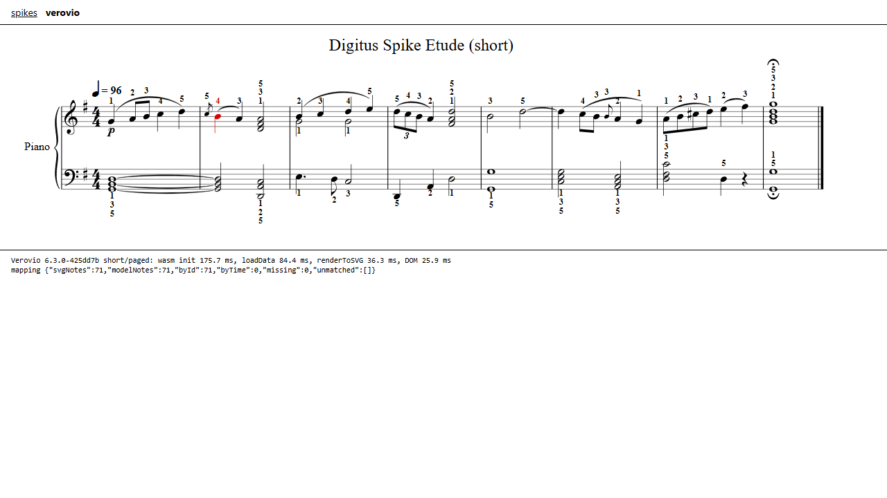 | OSMD, 8 bars: `n10` red; its grace note turns red with it; bar numbers 3/5/7 at digit height 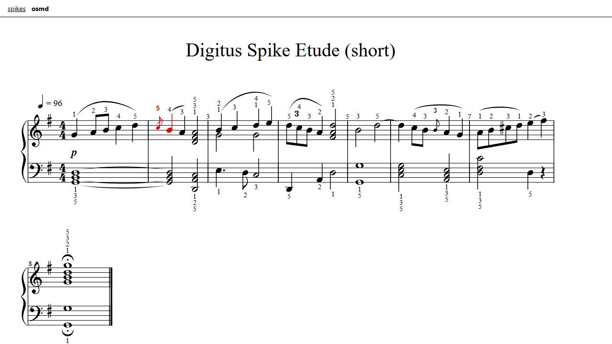 |
| Verovio, 120 bars 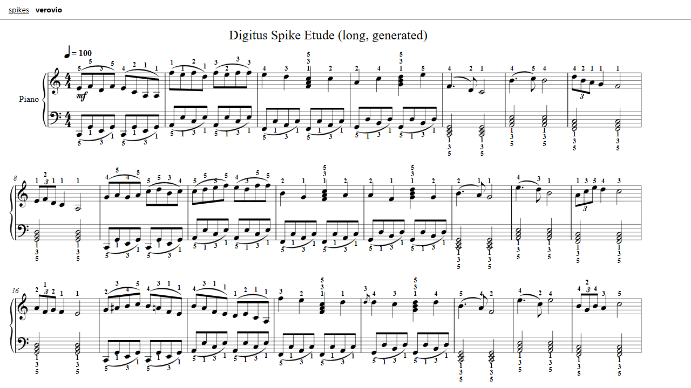 | OSMD, 120 bars 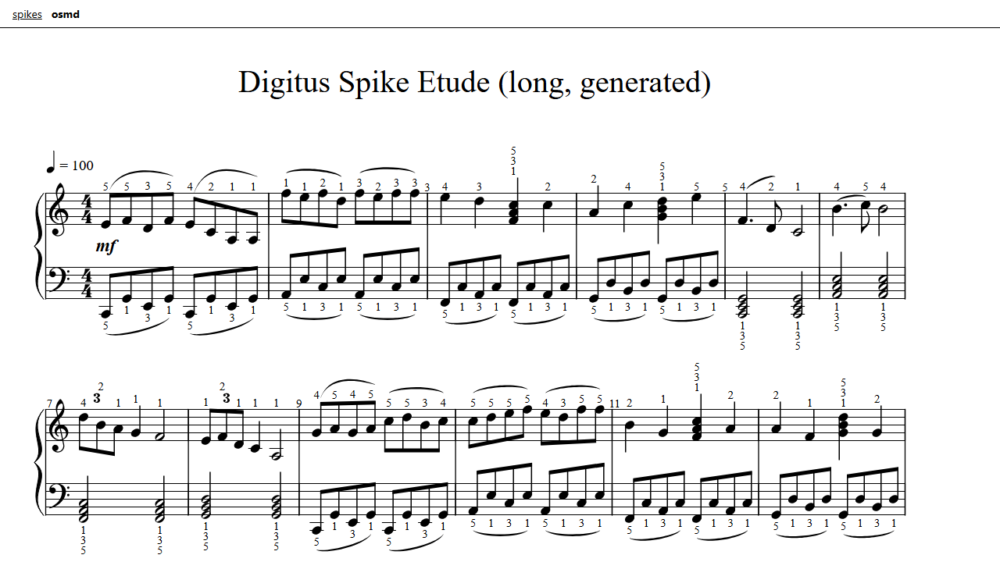 |
| Verovio, horizontal (`breaks: 'none'`) 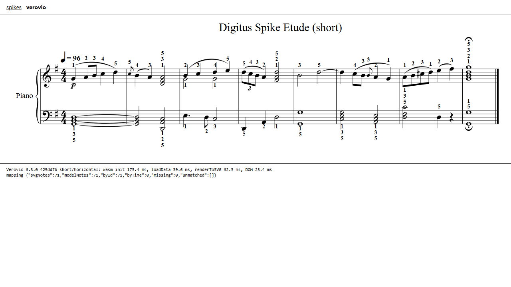 | OSMD, horizontal 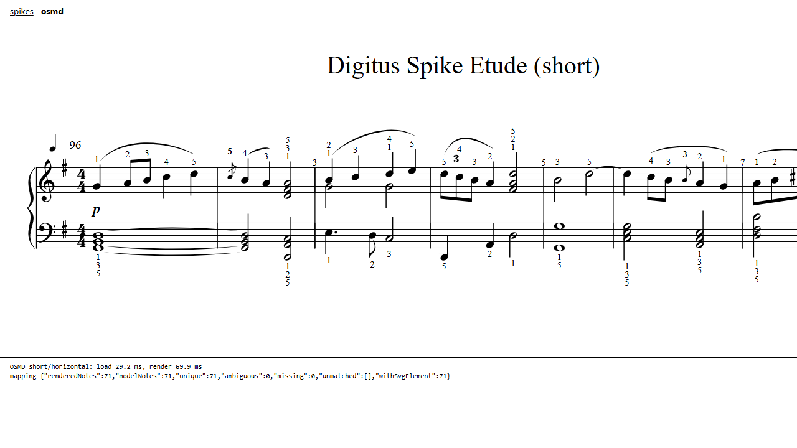 |
| Verovio at 360 px: reflows to 1 or 2 bars per system 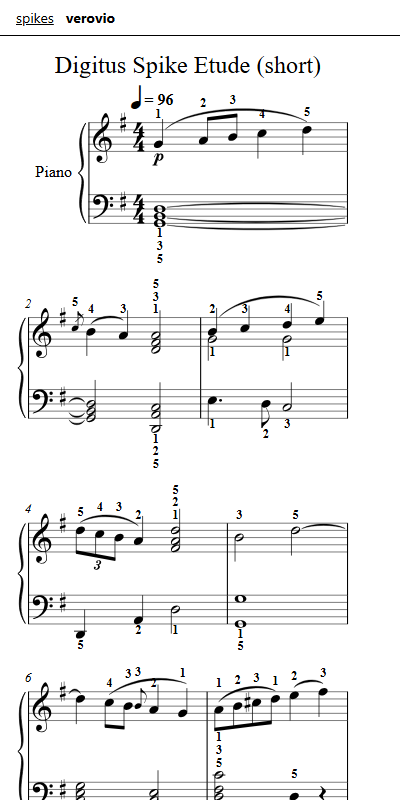 | OSMD at 360 px: title clipped, 1 bar per system 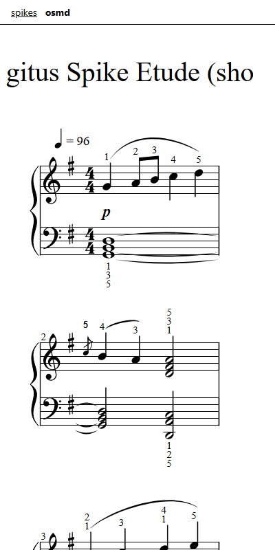 |
| vexml (canvas), `note.color.on()` 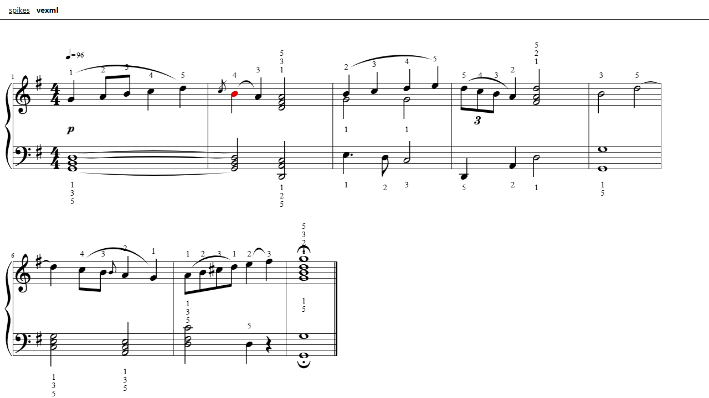 | VexFlow 5 direct, naive layout: collisions, no slurs 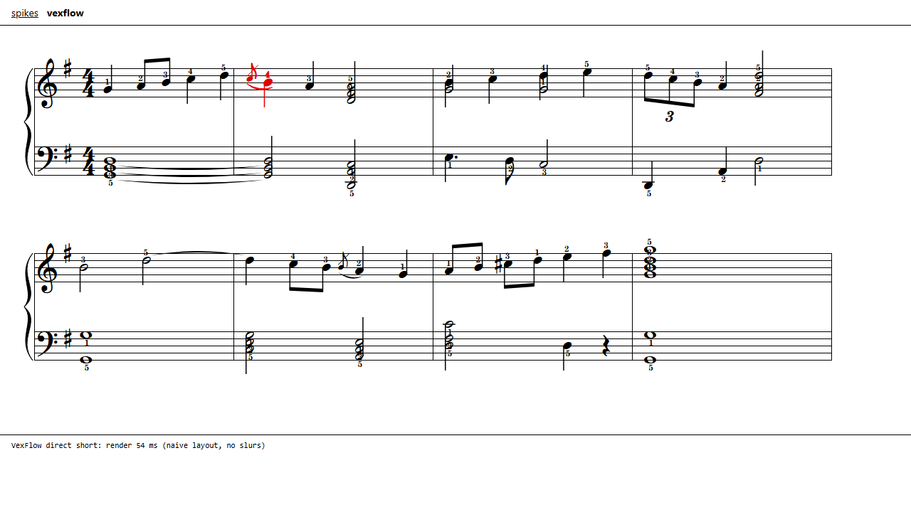 |

### 3.4 Verdict

- **Verovio.** The app's core is digits on every note, clicked, hovered, re-solved and animated. Verovio wins on all of that:
  - identity is free: SVG id equals our note id, and `data-startid` ties each digit to its note;
  - it honors per-voice placement and has no digit look-alikes at default settings;
  - color isolation is exact;
  - it reflows well at 360 px;
  - it can lay out off the main thread.
- **Its costs and the mitigations:**
  - 2.3 MB gzip of WASM: lazy chunk, HTTP-cached; loaded in parallel with the piano samples, which are at least as large.
  - 0.7 s for 120 bars on desktop and about 3.7 s at 4x CPU: render in a worker, show page 1 first; beginner pieces of 8 to 32 bars cost 50 to 250 ms.
  - No in-memory fingering edit: patch digits in place; re-load only when the set of fingered notes changes.
  - Slow horizontal mode for long pieces: use wrapped layout by default.
- **OSMD is the fallback** if bundle size, LGPL or long-piece speed turns out to matter more. Apply these settings if it is used:
  - `drawMeasureNumbersOnlyAtSystemStart: true`;
  - color `.vf-notehead` rather than the whole `vf-stavenote` group;
  - map notes after every render with the join in `src/render/osmd-render.ts`.
- **vexml** is promising (cursor, playhead and editing built in) but draws to canvas, so there is no CSS and no DOM node per digit. It is also young.
- **Direct VexFlow** would mean writing our own engraving engine.

## 4. Playback (question 2)

### 4.1 Players

Network numbers are cold-cache bytes over the network (Playwright). "Added latency" is the detected onset minus `ctx.currentTime` at the call; it excludes device output latency, which was 10 ms base + 40 ms output here. "Jitter" is the maximum deviation from the median onset error over 16 notes scheduled 0.5 s apart with sub-quantum offsets. Onsets were found sample-accurately by an AudioWorklet (`src/audio/onset-recorder.worklet.js`).

| Player | Lib gzip | Samples downloaded | Requests (incl. app JS) | Load | Added latency: "play now" / explicit time | Jitter | Samples and license | Maintenance |
|---|---|---|---|---|---|---|---|---|
| **smplr** `SplendidGrandPiano`, all 5 velocity layers | 9.6 KB (+3.2 KB with Sequencer) | 19 484 KiB ogg | 231 | 1009 ms | 0.0 / 0.0 ms | 0.0 ms | Akai "Splendid Grand Piano": public domain (SFZ by sfzinstruments). smplr itself: MIT on npm, no LICENSE file in the repo. | 16 releases in 2026, 1.0 in June |
| smplr Splendid, MF layer only (`notesToLoad.velocityRange`) | 〃 | 5 636 KiB | 67 | 456 ms | 0.0 / 0.0 | 0.0 | 〃 | 〃 |
| smplr Splendid, MF layer + only the piece's 21 pitches (playback demo) | 〃 | 2 468 KiB | 30 | 199 to 318 ms | 0.0 | 0.0 | 〃 | 〃 |
| smplr `Soundfont` acoustic_grand_piano (MusyngKite) | 〃 | 1 369 KiB | 6 | 440 ms | 5.1 / 5.1 | 0.0 | MusyngKite CC BY-SA 3.0, one velocity layer | 〃 |
| Tone.js 15 `Sampler`, self-hosted Salamander (30 mp3, every minor third) | 57.3 KB (Sampler + Transport) | 1 973 KiB | 38 | 279 ms | **114** / 14 | 0.0 | Salamander Grand Piano V3, **CC BY 3.0** (attribution required), one layer | very active (46 releases in 2025) |
| @tonejs/piano 0.2.1 (Salamander, `velocities: 1`) | 66.1 KB (with tone@14) | 5 500 KiB | 39 | 786 ms | **114** / 14.3 | 0.0 | Salamander, CC BY 3.0 | dead: last release 2020; **breaks on tone 15** ("Class extends value undefined"); needs a Node `events` polyfill and `webmidi` |
| soundfont-player 0.12 (MusyngKite) | 6.1 KB | 1 426 KiB | 6 | 447 ms | 6.2 / 6.2 | 0.0 | CC BY-SA 3.0 | **archived** repo, last release 2020 |
| soundfont-player (FluidR3_GM) | 〃 | 1 764 KiB | 6 | 634 ms | 5.4 / 5.4 | 0.0 | FluidR3 CC BY 3.0 | 〃 |
| `soundfont3` | – | – | – | – | – | – | – | **unpublished from npm** (2024-07-11) |
| spessasynth_lib 4.3 (SF2/SF3 synth + MIDI sequencer) | 95.9 KB | needs a SoundFont file, not measured | – | – | – | – | Apache-2.0; sound depends on the SF2 chosen | very active |

Every player schedules with `AudioBufferSourceNode.start(when)`, so timing is sample-accurate. The constant offsets come from leading silence in mp3/base64 encodings and can be compensated. Tone's 114 ms "play now" is its default `lookAhead` of 0.1 s.

### 4.2 Transport API: tempo, seek, loop, mute one hand, metronome

| | Tempo change | Seek | Loop range | Mute one hand | Metronome |
|---|---|---|---|---|---|
| **Our transport + smplr** (verified) | `setTempo(f)` re-anchors | `seek(sec)` in 0.1 ms | `setLoop(a, b)`: 0 notes outside the loop over 2.2 passes | `muted.add('L')`: 0 left-hand notes scheduled | oscillator click on beats from the score; 416.7 ms spacing at 96 bpm x 1.5 (expected 416.7) |
| smplr 1.1 `Sequencer` (verified, fake instruments) | `seq.bpm = 240`: 500 to 250 ms spacing | `seq.position = '7:1'` resumed at note 24 | `loop`/`loopStart`/`loopEnd` repeated r0..r3 | `muteTrack('L')`: 0 starts | `scheduleRepeat(cb, '4n')` with exact times |
| Tone.js `Transport` (documented, not exercised) | `bpm` (+ ramps or automation for tempo maps) | `seconds` / `position` | `loop`, `loopStart`, `loopEnd` | `Part.mute` per hand | `scheduleRepeat` / `Loop`; `Draw.schedule` |
| @tonejs/piano | instrument only, use Tone.Transport | | | | |
| soundfont-player | none: `play(note, when)`, `schedule`, `stop` | | | | |
| spessasynth_lib | MIDI sequencer: playback rate, current time, loop, channel mute (documented, not exercised) | | | | |

### 4.3 Demo and audio/visual sync

`playback.html` parses the MusicXML with our reader and renders it with Verovio (or `?renderer=osmd`). It loads smplr with only the needed samples, schedules with our transport, and colors the current onset group red from a `requestAnimationFrame` loop. Each switch is logged with the frame time and the time the onset leaves the speakers, which comes from `getOutputTimestamp()`. Results over 34 onsets of the 8-bar piece:

| Cursor clock | Verovio | OSMD | Verovio, 4x CPU |
|---|---|---|---|
| `getOutputTimestamp()` (compensated) | red **+5.0 ms** after the sound (median), range -0.4 to +15.8, p95 15.4 | +9.3, max 13.8 | +5.7, max 14.1 |
| `ctx.currentTime` (naive) | red **-40.7 ms before** the sound (median), range -49.5 to -32.2 | -41.4 | -40.9 |

rAF ran at 16.7 ms frames (max 16.8). Compensated sync is bounded by one frame. Aiming at the next frame (about +8 ms of lead) would center it on 0. The naive clock is early by the device output latency, which is 40 ms here and 150 to 250 ms on Bluetooth, so compensation is required. A scheduler bug found on the way: using an epsilon on look-ahead window boundaries double-triggered 3 notes. Windows must be half-open `[from, to)`.

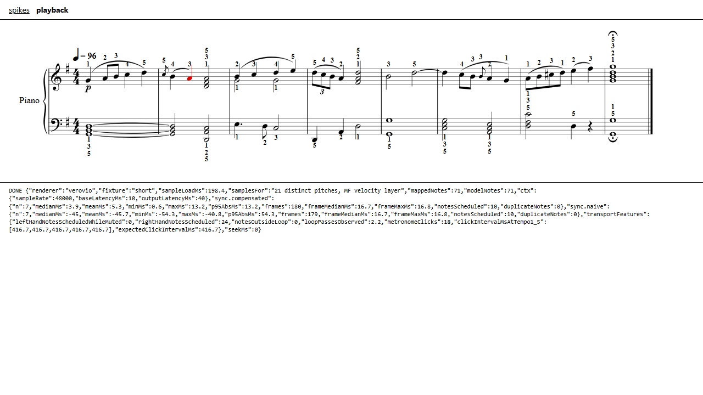

### 4.4 Verdict

Use smplr `SplendidGrandPiano`:
- best licensing (public domain), multi-layer samples;
- tiny library, zero added latency;
- load per piece with `notesToLoad`;
- self-host the `.ogg`/`.m4a` files later through its `baseUrl` option and HTTP or Cache Storage, so playback works offline.

Keep our own transport: it is the engine model's timeline (tempo map, hands, ties merged) and the cursor needs the same clock. smplr's `Sequencer` is a working plan B. Skip Tone.js: it is 57 KB, adds a 100 ms default look-ahead trap, and gives us no extra capability. Reject @tonejs/piano, soundfont-player and soundfont3 (all dead). Use spessasynth_lib only if General MIDI multi-instrument playback is ever wanted.

## 5. MIDI parsing (question 3)

Fixture: format 1 with a conductor track. Tempo goes 96 bpm, then 60 bpm at bar 5, then 120 bpm at bar 7. Expected onsets: bar 5 at 10.0 s, bar 7 at 18.0 s, last right-hand note at 21.5 s.

| | Gzip | API | Tempo map | Types | Result | Maintenance |
|---|---|---|---|---|---|---|
| **midi-file** 1.2.4 | 2.8 KB | `parseMidi(bytes)` gives raw events with `deltaTime`; also `writeMidi` | yours (15 lines, section 8.5) | bundled .d.ts | correct (10 / 18 / 21.5 s), under 0.1 ms | release 2023, repo active 2026-08 |
| @tonejs/midi 2.0.28 | 9.0 KB | `new Midi(buf)` gives `tracks[].notes{midi,ticks,time,duration}`, `header.tempos`, `ticksToSeconds` | applied | bundled .d.ts | correct; **drops the note-less conductor track**, so track indices shift | last release 2022-02 |
| midi-json-parser 8.1.75 | 3.3 KB (spawns a worker) | `await parseArrayBuffer(buf)` (async, via worker broker) | yours | bundled | correct | active 2026 |

Recommendation: midi-file. The spec's MIDI reader quantizes on a tick grid, so ticks plus our own tempo map are what we want. It is synchronous, tiny, and runs in Node, workers and tests.

## 6. MusicXML parsing for the engine (question 4)

Each "own reader" row runs the same about-180-line model builder (`src/model/musicxml.ts`; the reduced proof is in section 8.7). The builder works over a 4-field XML tree (`src/model/xnode.ts`), with one adapter per parser. It handles:
- parts, staves (hand = staff), voices and backup/forward;
- chords, merged ties and grace notes;
- tuplets and divisions changes;
- tempo map to seconds;
- fingering.

All variants produced identical models: 1473 notes, 1472 fingerings and 1185 chord groups (long); 71 notes, 67 fingerings and 4 merged ties (short). Times are for the 400 KB fixture.

| Approach | Browser (median, ms) | Node (median, ms) | Gzip | Worker / Node | Verdict |
|---|---|---|---|---|---|
| Own reader over **txml** 6.0.3 | 11.5 | 20.8 | 1.9 KB (reader + fflate + txml: 6.4 KB) | yes | fastest and smallest. Two caveats: it does not decode entities (we do), and you must pass `selfClosingTags: []` because the HTML defaults would swallow a MusicXML `<link>`. |
| Own reader over DOMParser | 31.0 | n/a | 0 (4.7 KB total) | main thread only | not usable in workers or Node |
| Own reader over @rgrove/parse-xml 5.0 | 23.2 | 35.4 | 4.1 KB | yes | spec-compliant and small |
| Own reader over **@xmldom/xmldom** 0.9.12 (M1 choice) | 79.5 | 129.9 | 29.5 KB | yes | slowest of the four, but a real W3C DOM plus `XMLSerializer` for the fingering writer. Acceptable at once per file load. |
| Own reader over fast-xml-parser 5.11 | 43.1 | 52.5 | 20.4 KB | yes | needs `preserveOrder: true` (note/backup order), awkward output |
| musicxml-io 0.12.1 | 7.0 (parse + `getAllNotes`) | – | 18.6 KB (25.3 KB with serialize + `addFingering`) | yes | MIT, typed, keeps note ids (`_id`), fingering in `notations[{technical:'fingering',text}]`, query and edit ops, `.mxl` built in. It does not give merged ties, seconds or hands directly, and it is v0.x with one maintainer (7 stars). Worth a look for the writer. |
| musicxml-interfaces 0.0.21 | 139.8 | – | 44.8 KB | yes | **AGPL-3.0**, unmaintained since 2022: blocker |
| @stringsync/musicxml 0.3.0 | 218.2 | – | 57.8 KB | needs DOM | XSD-shaped accessors, no timing, last release 2023 |
| @audio/musicxml 0.1.0 | 10.9 | – | – | yes | flattens to seconds but **drops staff and fingering**: unusable |
| OSMD's internal model (`osmd.load`, no render) | 65.9 | – | 350 KB | main thread, DOM | public and typed (`SourceMeasure` to `VoiceEntry` to `Note`, `TechnicalInstructions`), but tied to the renderer |
| @music-i18n/musicxml-player 1.5.1 | – | – | – | – | **GPL-3.0**. A player component (renders with OSMD or Verovio, gets MIDI and a timemap from Verovio or an API server, plays via spessasynth). It is not a parser and exposes no note model. |

`.mxl`: fflate `unzipSync` takes 1.4 ms in the browser and 1.0 ms in Node for the long piece, and is 2.7 KB gzip. jszip takes 3.9 ms and is 27.9 KB.

Recommendation: keep M1's own reader. `@xmldom/xmldom` + fflate is fine for M1. If parsing moves into a worker on phones, swap the XML layer to txml; it is a 20-line adapter, and the spike runs both behind the same interface. Do not adopt a MusicXML library as the model: none produces the engine model (hand, merged ties, seconds), and the two complete ones are AGPL or GPL.

## 7. App shell (question 5)

Sizes are a Vite production build. The marginal cost is measured over react 19.3 + react-dom (65.7 KB gzip).

| Option | Gzip | Decision |
|---|---|---|
| zustand 5.0 | +0.5 KB | **yes**: one store (score, assignment, playback, settings), persisted per piece |
| react-router 8.4 (declarative) | +12.8 KB | **no**: three views (library, score, export) are UI state; put the piece id in the URL hash |
| motion 14 `motion.div` + AnimatePresence | +43.3 KB | **no** |
| motion `LazyMotion` + `m` + `domAnimation` | +28.5 KB | no |
| `motion/react-mini` `useAnimate` | +3.0 KB | only if WAAPI ergonomics are needed |
| Tailwind 4.3 (sample transport bar + list) | 3.0 KB CSS (11.1 KB min) | **no**: vanilla CSS is 0.6 KB gzip for the same UI |

- **Styling: vanilla CSS with custom properties, optionally CSS Modules.** The design system is a handful of tokens: `--ink: #000`, `--paper: #fff`, a few grays, `--accent: #e3000f`, `--dur: 120–200ms`, `--ease`. A utility framework mostly invites colors we must not use. Enforce the single red with one class (`.is-current`) used by the score, the keyboard and the primary button.
- **Motion: CSS transitions for state changes**, plus `element.animate()` (WAAPI) for one-shots like the digit flash after a re-solve. Respect `prefers-reduced-motion`. The cursor itself must not animate: a class swap in the rAF callback is what keeps the sync within one frame.
- **Testing:**
  - vitest for the pure-TS engine (Node environment);
  - vitest + @testing-library/react + happy-dom for components;
  - Playwright for end-to-end, visual regression of rendered scores (stable because our ids are injected and Verovio's `xmlIdSeed` is fixed), and an audio/visual sync check reusing this spike's onset-recorder worklet;
  - Verovio also runs in Node, so SVG snapshot tests need no browser.

## 8. Snippets (TypeScript)

These are condensed from the spike sources, which were run. Paths are relative to `research/spikes/render/`.

### 8.1 Render MusicXML with fingerings (Verovio in a worker, our ids injected)

```ts
// render.worker.ts — layout and SVG off the main thread
import createVerovioModule from 'verovio/wasm';   // 2.3 MB gzip chunk, loaded on first use
import { VerovioToolkit } from 'verovio/esm';     // no typings shipped: see src/types/verovio.d.ts
let tk: VerovioToolkit | undefined;
self.onmessage = async ({ data }: MessageEvent<{ xml: string; widthPx: number }>) => {
  tk ??= new VerovioToolkit(await createVerovioModule());
  const scale = 40;
  tk.setOptions({
    scale, pageWidth: Math.round((data.widthPx * 100) / scale), adjustPageHeight: true, breaks: 'auto',
    footer: 'none', svgViewBox: true, svgRemoveXlink: true,
    svgAdditionalAttribute: ['fing@startid'],      // <g class="fing" data-startid="#noteId">
  });
  tk.loadData(data.xml);                           // MusicXML incl. <technical><fingering>
  const pages = Array.from({ length: tk.getPageCount() }, (_, i) => tk!.renderToSVG(i + 1));
  postMessage(pages);
};

// main thread: write our ScoreNote ids into the MusicXML first -> SVG <g class="note" id> === ScoreNote.id
export function injectNoteIds(xml: string, notes: { docIndex: number; id: string }[]): string {
  const byIndex = new Map(notes.map((n) => [n.docIndex, n.id])); // docIndex = position among <note> elements
  let i = -1;
  return xml.replace(/<note(\s[^>]*)?>/g, (m, attrs?: string) => {
    const id = byIndex.get(++i);
    return !id || (attrs && /\sid\s*=/.test(attrs)) ? m : `<note id="${id}"${attrs ?? ''}>`;
  });
}
worker.postMessage({ xml: injectNoteIds(xml, score.allNotes), widthPx: host.clientWidth });
worker.onmessage = ({ data }: MessageEvent<string[]>) => { host.innerHTML = data.join(''); };
```

### 8.2 Highlight note N red (the single red element)

```css
:root { --ink: #000; --paper: #fff; --accent: #e3000f; }
.score { color: var(--ink); background: var(--paper); }   /* Verovio paints with currentColor */
.score .is-current, .score .is-current * { fill: var(--accent); stroke: var(--accent); }
```

```ts
let current: Element[] = [];
export function highlight(noteId: string | null, withDigit = false) {
  for (const el of current) el.classList.remove('is-current');
  current = [];
  if (!noteId) return;
  const note = document.getElementById(noteId);                                   // SVG id === model id
  const digit = withDigit ? document.querySelector(`g.fing[data-startid="#${noteId}"]`) : null;
  for (const el of [note, digit]) if (el) { el.classList.add('is-current'); current.push(el); }
}
// click-to-select / hover: (e.target as Element).closest('g.note')?.id is the ScoreNote id
```

### 8.3 Add or change a fingering

```ts
// (a) re-solve changed existing digits: patch the SVG in place (1472 digits in 4 ms), no re-render
export function setDigits(changes: Map<string, string>) {        // noteId -> digit
  for (const [id, digit] of changes) {
    const g = document.querySelector(`g.fing[data-startid="#${id}"]`);
    const t = g?.querySelector('tspan tspan') ?? g?.querySelector('text');
    if (!g || !t || t.textContent === digit) continue;
    t.textContent = digit;
    g.animate([{ opacity: 0 }, { opacity: 1 }], { duration: 160, easing: 'ease-out' });
  }
}

// (b) a note gains a digit: edit the MusicXML, then re-render (8 bars about 45 ms; 120 bars about 0.7 s, in the worker)
import { DOMParser, XMLSerializer } from '@xmldom/xmldom';

// children of <note> that must come AFTER <notations> (MusicXML 4.0 note content model)
const AFTER_NOTATIONS = new Set(['lyric', 'play', 'listen']);

export function setFingering(xml: string, noteId: string, finger: string, placement?: 'above' | 'below'): string {
  const doc = new DOMParser().parseFromString(xml, 'application/xml');
  const note = Array.from(doc.getElementsByTagName('note')).find((n) => n.getAttribute('id') === noteId);
  if (!note) throw new Error('no <note id="' + noteId + '">');
  const child = (parent: Element, name: string) => Array.from(parent.childNodes).find((c) => c.nodeName === name) as Element | undefined;
  let notations = child(note as unknown as Element, 'notations');
  if (!notations) {
    notations = doc.createElement('notations') as unknown as Element;
    const before = Array.from(note.childNodes).find((c) => AFTER_NOTATIONS.has(c.nodeName));
    note.insertBefore(notations as never, (before ?? null) as never);
  }
  let technical = child(notations, 'technical');
  if (!technical) { technical = doc.createElement('technical') as unknown as Element; notations.appendChild(technical); }
  let fingering = Array.from(technical.childNodes).find((c) => c.nodeName === 'fingering' && (c as Element).getAttribute('substitution') !== 'yes') as Element | undefined;
  if (!fingering) { fingering = doc.createElement('fingering') as unknown as Element; technical.appendChild(fingering); }
  fingering.textContent = finger;
  if (placement) fingering.setAttribute('placement', placement);
  return new XMLSerializer().serializeToString(doc);
}

// OSMD fallback: edit the model and re-render (8 ms for 8 bars, 170 ms for 120 bars); no re-parse
// const ti = new TechnicalInstruction(); ti.type = TechnicalInstructionType.Fingering; ti.value = '3';
// ti.placement = 0 /* PlacementEnum.Above, not exported */; ti.sourceNote = note;
// note.ParentVoiceEntry.TechnicalInstructions.push(ti); osmd.render();
```

`scripts/snippet-check.ts` verifies (b): our reader sees the new digits, and Verovio goes from 67 to 68 `g.fing`, with `data-startid="#n15"` present and `n10` showing the new digit.

### 8.4 Playback with a sampled piano, synced to the cursor

```ts
import { SplendidGrandPiano } from 'smplr';
const ctx = new AudioContext({ latencyHint: 'interactive' });
const piano = SplendidGrandPiano(ctx, {   // only what this piece needs: about 2.5 MB instead of 19.5 MB
  notesToLoad: { notes: [...new Set(score.notes.map((n) => n.midi))], velocityRange: [85, 100], fallback: 'nearest' },
});
await piano.load;

// look-ahead scheduler: every 25 ms, start the notes whose onset falls in the next 150 ms
let t0 = 0, next = 0, tempo = 1;            // tempo = speed factor
const muted = new Set<'L' | 'R'>();
function play() {
  t0 = ctx.currentTime + 0.05; next = 0;
  setInterval(() => {
    const horizon = (ctx.currentTime + 0.15 - t0) * tempo;          // in score seconds
    while (next < score.notes.length && score.notes[next].onsetSec < horizon) {   // half-open windows
      const n = score.notes[next++];
      if (!muted.has(n.hand)) piano.start({ note: n.midi, velocity: 80, time: t0 + n.onsetSec / tempo, duration: n.durationSec / tempo });
    }
  }, 25);
  requestAnimationFrame(frame);
}

// cursor: use what is AUDIBLE now, not ctx.currentTime (that would be about 41 ms early here)
function frame() {
  const { contextTime = ctx.currentTime, performanceTime = performance.now() } = ctx.getOutputTimestamp();
  const audible = contextTime + (performance.now() - performanceTime) / 1000;
  highlight(noteAt((audible - t0) * tempo));    // binary search over onset groups -> note id
  requestAnimationFrame(frame);
}
```

The full version with seek, loop, mute and metronome is `src/audio/scheduler.ts`; the cursor and measurement code is `src/pages/playback.ts`.

### 8.5 MIDI to notes (midi-file + tempo map)

```ts
import { parseMidi } from 'midi-file';
export function midiToNotes(bytes: Uint8Array) {
  const { header, tracks } = parseMidi(bytes);
  const ppq = header.ticksPerBeat ?? 480;
  const tempos: { tick: number; us: number }[] = [];
  const notes: { midi: number; channel: number; track: number; startTick: number; endTick: number; onsetSec?: number }[] = [];
  tracks.forEach((events, track) => {
    let tick = 0;
    const open = new Map<string, number[]>();          // channel:pitch -> start ticks (overlaps)
    for (const e of events) {
      tick += e.deltaTime;
      if (e.type === 'setTempo') tempos.push({ tick, us: e.microsecondsPerBeat });
      else if (e.type === 'noteOn' && e.velocity > 0) { const k = e.channel + ':' + e.noteNumber; open.set(k, [...(open.get(k) ?? []), tick]); }
      else if (e.type === 'noteOff' || e.type === 'noteOn') {
        const start = open.get(e.channel + ':' + e.noteNumber)?.shift();
        if (start !== undefined) notes.push({ midi: e.noteNumber, channel: e.channel, track, startTick: start, endTick: tick });
      }
    }
  });
  tempos.sort((a, b) => a.tick - b.tick);
  if (!tempos.length || tempos[0].tick > 0) tempos.unshift({ tick: 0, us: 500_000 });
  const acc = [0];
  for (let i = 1; i < tempos.length; i++) acc[i] = acc[i - 1] + ((tempos[i].tick - tempos[i - 1].tick) / ppq) * (tempos[i - 1].us / 1e6);
  const sec = (t: number) => { let i = tempos.length - 1; while (i > 0 && tempos[i].tick > t) i--; return acc[i] + ((t - tempos[i].tick) / ppq) * (tempos[i].us / 1e6); };
  for (const n of notes) n.onsetSec = sec(n.startTick);
  return { ppq, tempos, notes };
}
```

The full version with velocity and duration is `src/snippets/midi-notes.ts`. It was checked by `scripts/midi-check.ts`: 10 s, 18 s and 21.5 s.

### 8.6 Loading `.mxl`

```ts
import { unzipSync, strFromU8 } from 'fflate';
export function unpack(bytes: Uint8Array): string {
  if (bytes[0] !== 0x50 || bytes[1] !== 0x4b) return strFromU8(bytes).replace(/^/, '');   // not a zip: plain XML
  const zip = unzipSync(bytes);
  const root = /full-path="([^"]+)"/.exec(strFromU8(zip['META-INF/container.xml'] ?? new Uint8Array()))?.[1]
    ?? Object.keys(zip).find((n) => !n.startsWith('META-INF') && /\.(musicxml|xml)$/.test(n))!;
  return strFromU8(zip[root]);
}
```

UTF-16 files (older Finale exports) need the BOM check from `src/model/mxl.ts`.

### 8.7 Proof: MusicXML to notes with timing, hand and fingering (about 50 lines)

The file is `research/spikes/render/src/model/proof.ts`, 55 lines. It runs in Node, workers and the browser. `scripts/proof-check.ts` checks it against the full reader:

| Fixture | Notes (proof / full reader) | Identical |
|---|---|---|
| short `.mxl` | 67 / 67 | 67 |
| short `.musicxml` | 67 / 67 | 67 |
| long | 1472 / 1472 | 1471 |

The single long-piece "difference" is a test-key collision: a grace note with the same pitch and onset as its main note.

```ts
import { DOMParser } from '@xmldom/xmldom';
// + unpack() from 8.6
export interface Note { midi: number; onsetQ: number; onsetSec: number; durQ: number; hand: 'R' | 'L'; staff: number; voice: string; chord: boolean; grace: boolean; finger?: string }
const SEMI: Record<string, number> = { C: 0, D: 2, E: 4, F: 5, G: 7, A: 9, B: 11 };
const kid = (e: Element, n: string) => Array.from(e.childNodes).find((c) => c.nodeName === n) as Element | undefined;
const val = (e: Element | undefined, n: string) => (e && kid(e, n)?.textContent?.trim()) ?? undefined;

export function readNotes(xml: string): Note[] {
  const doc = new DOMParser().parseFromString(xml, 'application/xml') as unknown as Document;
  const notes: Note[] = [], tempos: [number, number][] = [], open = new Map<string, Note>();
  for (const part of Array.from(doc.getElementsByTagName('part'))) {
    let div = 1, staves = 1, start = 0;
    for (const m of Array.from(part.getElementsByTagName('measure'))) {
      let pos = 0, max = 0, last = 0;
      for (const el of Array.from(m.childNodes).filter((n): n is Element => n.nodeType === 1)) {
        if (el.nodeName === 'attributes') { div = Number(val(el, 'divisions') ?? div); staves = Number(val(el, 'staves') ?? staves); }
        else if (el.nodeName === 'backup') pos -= Number(val(el, 'duration')) / div;
        else if (el.nodeName === 'forward') { pos += Number(val(el, 'duration')) / div; max = Math.max(max, pos); }
        else if (el.nodeName === 'direction' || el.nodeName === 'sound') {
          const t = (el.nodeName === 'sound' ? el : kid(el, 'sound'))?.getAttribute('tempo'); if (t) tempos.push([start + pos, Number(t)]);
        } else if (el.nodeName === 'note') {
          const chord = !!kid(el, 'chord'), grace = !!kid(el, 'grace'), dur = grace ? 0 : Number(val(el, 'duration') ?? 0) / div;
          const onset = chord ? last : pos;
          if (!chord) { last = pos; pos += dur; max = Math.max(max, pos); }
          const p = kid(el, 'pitch'); if (!p) continue; // rests, unpitched
          const staff = Number(val(el, 'staff') ?? 1), midi = 12 * (Number(val(p, 'octave')) + 1) + SEMI[val(p, 'step')!] + Number(val(p, 'alter') ?? 0);
          const ties = Array.from(el.getElementsByTagName('tie')).map((t) => t.getAttribute('type'));
          const head = open.get(staff + ':' + midi);
          if (ties.includes('stop') && head) { head.durQ += dur; if (!ties.includes('start')) open.delete(staff + ':' + midi); continue; } // merge tie
          const fing = Array.from(el.getElementsByTagName('fingering')).find((f) => f.getAttribute('substitution') !== 'yes');
          const n: Note = { midi, onsetQ: start + onset, onsetSec: 0, durQ: dur, staff, hand: staves > 1 && staff > 1 ? 'L' : 'R', voice: val(el, 'voice') ?? '1', chord, grace, finger: fing?.textContent?.trim() || undefined };
          notes.push(n);
          if (ties.includes('start')) open.set(staff + ':' + midi, n);
        }
      }
      start += max;
    }
  }
  const tm = tempos.length ? tempos.sort((a, b) => a[0] - b[0]) : [[0, 120] as [number, number]];
  if (tm[0][0] > 0) tm.unshift([0, tm[0][1]]); // tempo map: [quarter position, bpm]
  const sec = (q: number) => { let s = 0, i = 0; for (; i + 1 < tm.length && tm[i + 1][0] <= q; i++) s += ((tm[i + 1][0] - tm[i][0]) * 60) / tm[i][1]; return s + ((q - tm[i][0]) * 60) / tm[i][1]; };
  for (const n of notes) n.onsetSec = sec(n.onsetQ);
  return notes.sort((a, b) => a.onsetQ - b.onsetQ || a.midi - b.midi);
}
```

The proof omits what the engine reader adds: timewise conversion, cross-staff notes, `<cue>`, repeats expansion, grace timing, and per-note ids with `docIndex` (needed by `injectNoteIds`).

## 9. Risks and soft blockers

| Risk | Impact | Mitigation |
|---|---|---|
| Verovio LGPL-3.0-or-later inside an MIT app | compliance | Ship the unmodified npm build as its own lazily loaded chunk (it already is a separate `verovio-module-*.js`). Add the LGPL text, attribution and a source link (github.com/rism-digital/verovio) to the about page. Do not patch it; if we ever must, publish the patch. |
| Verovio 2.3 MB gzip and 1.4 s WASM init at 4x CPU | first open on phones | Lazy import on the score view and preload it from the library view. Compile once per session (the worker keeps the instance). The service worker caches it. |
| Verovio long-piece layout: 0.7 s desktop, 3.7 s at 4x | jank | Worker rendering (the main thread is only busy for the insert), page 1 first, wrapped layout, relayout only at breakpoints (otherwise scale via `svgViewBox`) |
| No API to add a `<fing>` to Verovio's loaded document | edit latency | Digits always exist after the first solve, so patch them in place (section 8.3a). Re-load only on add or remove. |
| No Verovio typings | DX | 36-line ambient module (`src/types/verovio.d.ts`), owned by the renderer adapter |
| OSMD (if used): colors leak to grace notes in the same group; lower-voice placement ignored; bar numbers look like digits | readability | Color `.vf-notehead`; `drawMeasureNumbersOnlyAtSystemStart`; accept stacked digits or switch to Verovio |
| smplr repo has no LICENSE file (npm says MIT); hosted samples on `smpldsnds.github.io` | supply chain, offline use | Self-host the needed `.ogg`/`.m4a` (public domain) next to the app; pin the version |
| Salamander (Tone / @tonejs/piano) is CC BY 3.0, MusyngKite is CC BY-SA | attribution or share-alike | Not chosen. If used, credit them in the app. |
| Output latency varies by device (Bluetooth 150 to 250 ms) | perceived sync | Always map through `getOutputTimestamp()`. Optionally offer a user calibration offset. |

## 10. Reproduce

```bash
cd research/spikes/render
pnpm install            # this folder is its own pnpm workspace root (pnpm-workspace.yaml): never touches the repo lockfile
pnpm fetch:samples      # 1.9 MB Salamander subset for the self-hosted Tone.Sampler case (gitignored)
pnpm dev                # http://localhost:4316; index.html links every page (?auto=1 runs a bench)
pnpm build && pnpm preview          # http://localhost:4317
pnpm measure            # Playwright headless -> results/*.json, screenshots/*.png (RUNS=7; CPU_THROTTLE=4; args: base url, job filter)
pnpm sizes && pnpm sizes:css        # bundle sizes -> results/bundle-sizes.json; Tailwind vs vanilla CSS
pnpm check:node                     # proof vs full reader, snippet checks, MIDI check, Node parser bench
pnpm typecheck                      # TypeScript 7.0.2 strict over all spike sources: 0 errors
```

Playwright 1.59.1 is pinned because it uses the Chromium build (147, revision 1217) already installed on this machine. Elsewhere, run `pnpm exec playwright install chromium`.

Main files:
- `src/model/`: our reader, the XML adapters, `.mxl` and the proof;
- `src/render/`: Verovio and OSMD helpers;
- `src/audio/`: transport and onset recorder;
- `src/pages/`: one page per experiment;
- `src/snippets/`: tested doc snippets;
- `scripts/`: fixture generator, sample fetch, Playwright driver, size probes, Node checks;
- `bundle/`: size probes.

## 11. Process notes

- **Two writers in the spike folder.** From about 20:59 a second instance of the spike agent wrote into the same folder. It added `scripts/measure.mjs`, `src/pages/{midi,parsers}.ts` and an alternative `playback.ts`. Its files were kept and fixed:
  - track selection in `midi.ts`;
  - a fingering probe in `parsers.ts`;
  - a hashed fixture URL.

  Its `playback.ts` was replaced because it added the output latency instead of subtracting it. `research/spikes/render/COORDINATION.md` has the timeline.
- **Root workspace touched once.** One `pnpm install --frozen-lockfile` in the spike folder at 21:27 resolved to the new root workspace, because pnpm ignores `ignore-workspace` in `.npmrc`. The root `pnpm-lock.yaml` was not modified (frozen), but the root `node_modules/.modules.yaml` and `.bin` were re-linked. A spike-local `pnpm-workspace.yaml` now prevents this.

## Sources

- Verovio: https://www.verovio.org, https://github.com/rism-digital/verovio (LGPL-3.0)
- OpenSheetMusicDisplay: https://github.com/opensheetmusicdisplay/opensheetmusicdisplay (BSD-3-Clause)
- vexml: https://github.com/stringsync/vexml; VexFlow: https://github.com/vexflow/vexflow
- smplr: https://github.com/danigb/smplr; Splendid Grand Piano samples (public domain, Akai): https://github.com/sfzinstruments/SplendidGrandPiano
- Salamander Grand Piano V3 (CC BY 3.0): https://archive.org/details/SalamanderGrandPianoV3; @tonejs/piano: https://github.com/tambien/Piano
- MIDI.js soundfonts (FluidR3_GM CC BY 3.0, MusyngKite CC BY-SA 3.0): https://github.com/gleitz/midi-js-soundfonts
- soundfont-player (archived): https://github.com/danigb/soundfont-player; Tone.js: https://github.com/Tonejs/Tone.js; spessasynth_lib: https://github.com/spessasus/spessasynth_lib
- @tonejs/midi: https://github.com/Tonejs/Midi; midi-file: https://github.com/carter-thaxton/midi-file; midi-json-parser: https://github.com/chrisguttandin/midi-json-parser
- musicxml-io: https://github.com/tan-z-tan/musicxml-io; musicxml-player (GPL-3.0): https://github.com/infojunkie/musicxml-player
- Web Audio `getOutputTimestamp`: https://developer.mozilla.org/docs/Web/API/AudioContext/getOutputTimestamp
- npm publish dates and versions: `pnpm view <pkg> time` on 2026-10-13; GitHub repo metadata via api.github.com on 2026-10-13
