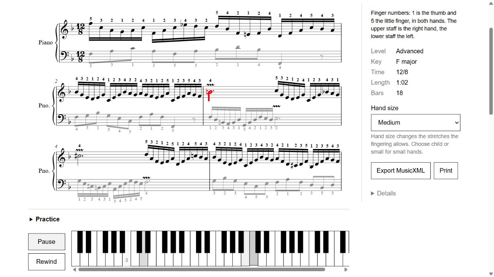
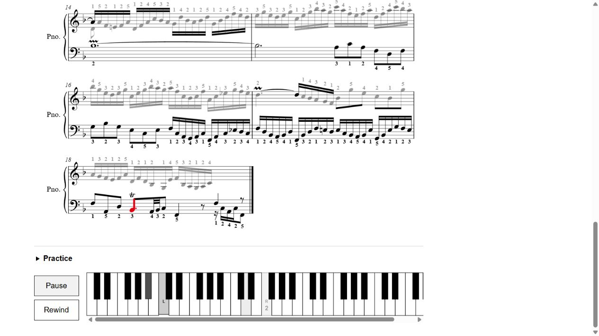

# Ornament playback review, 2026-10-16

The user approved automatic trill and mordent playback in a separate worktree and requested a PR to main. Implementation is on `codex/ornament-playback`; final full verification passed and this branch is ready for its separate PR. No merge or deployment is authorized. Codex — Sol 6.1 implementation and independent review; Astra coordination.

## Scope and source evidence

The supplied unstroked zigzag belongs to the upper-mordent family. MusicXML names it `inverted-mordent`; the [official reference](https://www.w3.org/2021/06/musicxml40/musicxml-reference/elements/inverted-mordent/) explains the naming difference from SMuFL. The actual BWV856 library MusicXML contains 10 long upper mordents, two short upper mordents and one trill. Rendering and fingering export already preserved these signs; the missing behavior was playback.

The parser now retains supported ornament metadata, and one pure helper supplies audio attacks and keyboard pitches. Source notes, IDs, timing and principal fingering inputs stay intact; auxiliary pitches get no invented digit. Raw MusicXML is unchanged, and fingering export retains the source ornaments. Samples and keyboard range include auxiliary pitches without a new visible control.

Short/long mordents use three/five attacks; trills alternate with the upper diatonic neighbor at roughly eight attacks per score second. Realization stays inside the first written segment, followed by the principal hold across ties. Active key signatures and earlier accidental scope are resolved by part/staff and musical position. Supported explicit starting note, bounded integer attack count, chromatic step and ornament accidental instructions take precedence. See the [MusicXML trill reference](https://www.w3.org/2021/06/musicxml40/musicxml-reference/elements/trill-mark/).

## Independent review and fixes

| Confirmed issue                                                                   | Final behavior and regression proof                                                                                                                                |
| --------------------------------------------------------------------------------- | ------------------------------------------------------------------------------------------------------------------------------------------------------------------ |
| An ornament on the second voice of a deduplicated unison disappeared.             | Resolve metadata before deduplication and retain the first supported sign on the surviving note; original ID, source indices and fingering behavior remain intact. |
| A tied principal tail overlapped the next loop's auxiliary.                       | Clip scheduled sound at the actual loop end, without clipping at ordinary lookahead horizons.                                                                      |
| A later key signature leaked backward through a MusicXML backup.                  | Locate keys by part/staff, measure and offset; apply key changes and accidental resets in musical time.                                                            |
| A live tempo change split an already scheduled attack, creating a gap or overlap. | Schedule through a safe attack edge before changing factor; independent slowdown/speedup and repeated-request checks preserve phase and continuity.                |

The tempo transition has a hard 250 ms context-time bound, including existing lookahead. The reviewed safe case deferred 222.2 ms. Interleaved 31/32-attack long trills with no timely common edge resynchronize immediately using the existing seek path, restart both sounding pitches and resume the new factor. Production uses its existing 50 ms seek delay; this rare fallback rearticulates held notes. The reviewer separately exercised that real delay, loop edges and repeated tempo requests, and reported no remaining important or critical findings. Final principal holds retain the ordinary transport's existing timing limitations.

## Verification state

| Check                                                                     | Verification result                                                                                                     |
| ------------------------------------------------------------------------- | ----------------------------------------------------------------------------------------------------------------------- |
| Focused MusicXML parser/export regression files                           | 53 passed                                                                                                               |
| Focused ornament and existing transport regression files                  | 37 passed                                                                                                               |
| Focused total                                                             | 90 passed                                                                                                               |
| TypeScript checks                                                         | Passed                                                                                                                  |
| Formatting of changed files                                               | Passed                                                                                                                  |
| Earlier browser acceptance on isolated port 4208                          | Passed: unwritten upper key without a false digit, principal key with its digit, unchanged score cursor, loop and pause |
| Final serial `pnpm verify` after review fixes and latest-main integration | Passed: all 11 gates; 879 engine, 330 web and 179 browser tests                                                         |

Tests were added and observed failing before each reviewed fix. The complete final run passed after the review fixes, main 1d553ef integration, local benchmark-data setup and test-only race correction. Evidence is in ignored benchmarks/runs/ornament-verify-complete.log; the final build/bundle and browser gates passed. The coordinator independently exercised the same product implementation below.

The first full run (`benchmarks/runs/ornament-verify-final.log`) exposed an unused fake-clock destructure, missing local research fixtures and an existing keyboard-test sampling race. The test had selected a pressed/muted key in one browser task and read it after playback released it. A deterministic control reproduced `split: [false]` versus `atomic: [true]`; its ignored result is `benchmarks/runs/ornament-keyboard-race-control.json`. Selecting and reading in one `page.evaluate` fixes that race while preserving every assertion. The unused variable was removed. Lint and the eight ornament transport tests then passed, and the exact failed browser test passed three consecutive runs on isolated port 4209. The coordinator owns restoring local fixtures and the final complete rerun; no full-pass claim follows from these narrow checks.

## Limits

The defaults do not claim historically authentic Baroque performance, and the solver still fingers written principal notes rather than teaching an alternating-finger technique. Unsupported compound, accelerating and microtonal ornaments remain visible with ordinary held-note playback. Trill extension lines do not create additional sounding notes across later written segments. Source notes and notation remain available for external correction or interpretation.

## Final actual-browser check

After the four review fixes and main integration, the coordinator opened the real BWV856 library piece in a separate production preview, using the normal piano path. With bar 3 looped at 50% and the right hand selected, the unwritten C5 (MIDI 72) was pressed with empty text while the score cursor remained on n70; the principal B4 (MIDI 71) retained finger 4 on that same cursor. All 13 ornament glyphs remained rendered. With bar 18 looped and the left hand selected, the trill's auxiliary C3 (MIDI 48) was pressed without a finger digit while the cursor stayed on n569. Playback paused normally after each check. These are actual UI observations; audio attack timing is additionally covered by the independent scheduler checks.

The public-domain library source is the existing Mutopia BWV856 edition. No private score was used in these captures.

