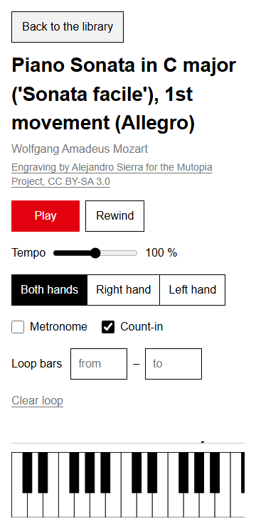
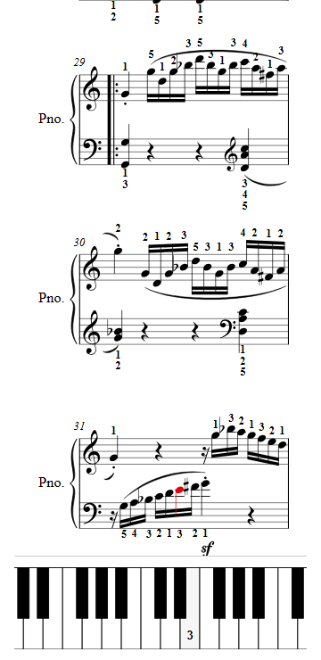

# UI review, 2026-10-14

- Date: 2026-10-14
- Build: commit `e3cfe3a` (`git log -1 --format=%h`), `vite build` of `apps/web` served by `vite preview --port 4181`.
- Reviewer: independent Opus subagent, verification spec section 3.10 (first periodic review). No product code was edited.
- Browser: Playwright's Chromium 1217 (scripted walk, screenshots, DOM and pixel checks), plus a first look in the desktop app's browser pane. Widths: 1280 x 900 and 360 x 740.
- Audio: `?audio=silent` for most of the walk; one run with the real instrument to see the first Play (samples come from `smpldsnds.github.io`). I could not listen, so sound and sync were not judged by ear.

## What I did (the walk)

| Step | Desktop 1280 | Phone 360 | Result |
| --- | --- | --- | --- |
| Open the library, read the welcome | yes | yes | Clear. The red "Start with Twinkle" is the obvious first step. |
| Open the recommended piece (Twinkle) | yes | yes | 0.36 s to the first digit. All 64 digits shown. |
| Read the fingering | Twinkle, Mary, Ode to Joy, Frère Jacques, Jingle Bells, Happy Birthday, Melody, K.545 | Twinkle, Melody, K.545 | Digits are legible and sit next to the right notes. Teacher notes below. |
| Press Play, watch the cursor and the keyboard | yes, silent and real instrument | yes, silent | The cursor and the pressed keys follow the music. There is no feedback while samples load or during the count-in. |
| Change tempo, then right hand only, then left hand | 70 %, R, L | same | Works. The muted hand is not dimmed, and "70 %" stays next to the score's printed tempo "♩ = 100". |
| Switch hand size | Medium, Child, Large | same | Child changed 13 of 64 Twinkle digits with a 160 ms fade. Large gave the same digits as Medium. |
| Turn the editor's fingering on and off | Schumann Melody (level 2) | Melody | Switched in 150 ms: 254 engine digits, 27 editor digits. |
| Open a long piece (Mozart K.545) | yes | yes | 0.53 s to the first page and 0.54 s to all 1288 digits (warm worker). |
| Loop bars | K.545 bars 5 to 6 and 30 to 31 | K.545 bar 5 | Works. A reversed range (from 6, to 2) is ignored with no message. |
| Export | Melody (254 fingerings in the file), K.545 (91 ms) | — | Download named `<slug>.fingered.musicxml`, UTF-8. |
| Print (print media emulated) | Frère Jacques | — | Score only, nothing red. |
| About page | yes | yes | Clear. The licence table reflows to three columns at 360. |
| Drop a MusicXML file (copy of a library score) | chooser and a real `drop` event | same | Opens straight into the score, titled from the file. |
| Drop wrong files | `notes.txt`, `song.mid`, `broken.xml` | same | The txt and MIDI files get a gray notice at the top of the viewport. The broken XML gets a clear error page with a red "Back to the library". |
| Go back | Back button, browser back and forward, reload of a dropped file, unknown slug | same | All work. A reload of a dropped file says "Drop the file again to continue". An unknown slug falls back to the library without saying so. |
| Play to the end | Frère Jacques at 150 % | — | Stops, Play is red again, and Play restarts from bar 1. |

Automated checks I ran at every step: a computed-style walk over every visible element (color, background, borders, outline, fill, stroke), which counts red roots and any other non-gray color; a horizontal-scroll check; and, on four screenshots, a pixel audit.

## Findings by screen

Severity: blocker (a beginner cannot proceed), major (a beginner will be confused or stuck), minor (friction), nit (polish). There are no blockers.

### Library (welcome)

| # | Severity | Finding |
| --- | --- | --- |
| L1 | minor | The file drop zone and the About link sit at the very end of a 30-row list: y = 2883 of 3065 px at 1280, and y = 3884 of 4089 px at 360. Nothing near the top says you can open your own score. A user who has a MusicXML file will not find the drop zone without scrolling past every piece. |
| L2 | minor | Back from a score always lands at the top of the library (scrollY 0), even if the piece was opened from Level 4 (scrollY 1852). The reader loses their place. |
| L3 | nit | The "Start here" card repeats the first row of Level 1. The levels are named but not explained (what "Early intermediate" asks of the hands). |
| L4 | nit | `#/piece/does-not-exist` falls back to the library with no notice. |

Clear what to do next: yes. The red button is the obvious first action, and the welcome line ("Pick a piece, press play, and follow the red note") is short and right.

### Score view

| # | Severity | Finding |
| --- | --- | --- |
| S1 | major | **Pause scrolls out of reach during playback.** The transport is not sticky, and the cursor's auto-scroll follows the music. While K.545 bars 30 to 31 played, the Pause button was 1578 px above the viewport at 1280 and 5454 px above it at 360. Space does not toggle playback (after arrival the focus is on the `h1`). To stop, the user has to scroll up against the auto-scroll. See `phone-k545-playing-bar-30.png`. |
| S2 | major | **On a phone, a score opens with no music in view.** The title, the transport (304 px tall at 360) and the sticky keyboard (124 px) fill the first screen. K.545 shows no staff at all (`phone-k545-arrival.png`), and Twinkle shows a sliver of about 75 px. Opening a piece from lower down the library is worse: the new view keeps a clamped scroll offset (scrollY 578 for K.545, 476 for the G major Minuet), so the title and Play are *above* the viewport. The cause is that `focus.ts` focuses the heading with `preventScroll: true` and nothing scrolls the view to the top. The desktop is not affected (scrollY 0). |
| S3 | major | **Play gives no feedback while it is working.** On the first real Play, the samples took 2.35 s to load. During that time the button still read "Play" and stayed red, and the only change was `cursor: progress` (invisible on touch). Then the count-in (on by default) held the red cursor on the first notes, with keys 5 and 1 pressed, for another 2.4 s before anything was meant to sound. A beginner sees about 4.8 s of a "stuck" first note and will likely press again. No status line says "Loading the piano…" or counts "1 2 3 4" (`desktop-twinkle-count-in.png` was taken 2.5 s into the count-in). |
| S4 | major | **The finger numbers are never explained.** No screen says that 1 is the thumb and 5 the little finger in both hands, or that numbers above the top staff are for the right hand and below the bottom staff for the left. (In Schumann's Melody, both staves are treble clef.) The keyboard shows digits with no L or R. This is the one piece of knowledge a beginner needs to use the app at all. |
| S5 | major | **The cursor is small.** The red element during playback is the notehead itself, 9 x 8 px at both widths. That is 46 red pixels in the 360 px screenshot of K.545. It is easy to lose in a sixteenth-note run, and the brief's promise is "follow the red note". The pressed keys use `--gray-1` (#f2f2f2) on white, almost invisible; the digit is the only cue. |
| S6 | major (content) | **Every note carries a digit.** Melody has 254 engine digits against the editor's 27 (`desktop-melody-engine-digits.png`). In its left hand the digits form two rows under the staff, and K.545 bar 29 stacks digits against the slur and beams. This is the known M5 readability reduction, but it is the single biggest readability problem a teacher would see. |
| S7 | minor | Developer text in the side panel: "Fingered in 6 ms · laid out in 63 ms" on every piece, and for Melody two engine warnings ("note 95: duplicate of note 91 (same hand, onset and pitch), dropped"). A beginner cannot act on either. The timing line still says "Fingered in" when the editor's fingering is shown. |
| S8 | minor | The tempo control reads "70 %" while the score still prints "♩ = 100". The setting persists across pieces and reloads (150 % and count-in off survived a reload and carried to the next piece), so a beginner who slowed one hard piece will find every piece slow. |
| S9 | minor | Hand size (Large, Medium, Small, Child) has no explanation of what it changes. A beginner may read "Child" as an easier mode. On Twinkle, Large and Medium give identical digits. |
| S10 | minor | One-hand practice does not dim the muted hand's staff or digits, so the score does not show what is being played. |
| S11 | minor | A reversed loop range (from 6, to 2) is silently ignored. "Clear loop" looks like a gray underlined link when it is disabled. |
| S12 | minor | The editor's fingering has no on-score label. With the checkbox off-screen (phone, or scrolled), nothing says whose digits are shown, and the jump from 254 to 27 digits can look like a bug. |
| S13 | nit | The "Piano" and "Pno." instrument labels cost about 45 px of every system at 360 (Melody fits one bar per system). At 1280 the music is drawn at the same fixed size as on a phone (`VEROVIO_SCALE = 40`, noteheads 9 px, digits 14 px boxes, Times bold), leaving the wide column underused. This is readable, but small for a laptop on a music stand. |
| S14 | nit | The auto-scroll to the cursor uses the browser's smooth scroll, which is longer than the brief's 120 to 200 ms. |

What works well: Play is unmistakably the next step on a stopped score. The hand-size re-solve is instant with a quiet fade. K.545 opens in about half a second; this run measured 0.54 s to all digits, faster than the 2.37 s in `docs/app.md`'s performance table, which may be stale. The keyboard follows the pressed keys at 360 and scrolls inside itself, with no page overflow. The loop works, export works, the print view is clean, and the end of a piece returns cleanly to Play.

### Dropped file and errors

| # | Severity | Finding |
| --- | --- | --- |
| F1 | nit | A dropped file opens immediately. The spec's "Finger it" confirm step (spec section 9, view 1) is skipped. That is simpler and I think better, but the spec should say so. |
| F2 | nit | The wrong-file notice ("That does not look like a MusicXML file (.musicxml, .xml or .mxl).") is clear and appears at the top of the viewport even when the user is scrolled to the drop zone. The broken-XML error page is the best error screen in the app: one plain sentence, a muted detail, and one red way back. |

### About

No findings beyond a nit: the page explains the engine ("picks the cheapest one for the whole piece with an exact search") but not how to read the numbers, which belongs here too (see S4).

## Design-brief check, per screen

The red root and other-color columns come from the computed-style walk. The last column is the visible viewport, because the brief says "on screen".

| Screen / state | Width | Red root | Other chromatic elements | Red visible in viewport | Horizontal scroll |
| --- | --- | --- | --- | --- | --- |
| Library, top | 1280, 360 | "Start with Twinkle" | 0 | 1 | none |
| Library, scrolled to drop zone / drag-over | 1280, 360 | "Start with Twinkle" (off-screen) | 0 | **0** | none |
| Library with notice (txt, MIDI) | 1280, 360 | "Start with Twinkle" | 0 (notice is gray) | 1 at the top, 0 when scrolled | none |
| Score ready (Twinkle, Happy Birthday, Melody, K.545, dropped Ode to Joy) | 1280, 360 | Play | 0 | 1; **0** once a long score is scrolled | none |
| Score, samples loading (real instrument) | 1280 | Play (aria-busy) | 0 | 1 | none |
| Score, count-in | 1280, 360 | cursor: 2 noteheads, same onset | 0 | 1 cursor | none |
| Score playing, both hands, one hand, loop | 1280, 360 | cursor noteheads or chord, one onset | 0 | 1 cursor | none |
| Score paused, ended | 1280 | Play | 0 | 1 | none |
| Score, editor's fingering on | 1280 | Play | 0 | 1 | none |
| Error (broken.xml) | 1280 | "Back to the library" | 0 | 1 | none |
| About | 1280, 360 | "Back to the library" | 0 | 1 | none |
| Print media | 1280 | none | 0 | 0 (intended) | none |

- Exactly one red element: holds in every DOM state. The gap is the viewport: a scrolled library or a scrolled stopped score shows no red at all, so the "one red = the next action" cue disappears exactly when the reader is deep in the content (fixes 1 and 9).
- Nothing else chromatic: holds. The pixel audit found non-gray pixels only at glyph edges, with the typical subpixel text-antialiasing pattern (for example rgb(87,0,0) next to rgb(0,39,143)). Thin digits such as "1" and the italic bar numbers can look faintly red in screenshots for this reason. Their computed fill is `rgb(0, 0, 0)`, so this is not a product defect. Accent pixels sat only inside the expected element: 4022 px in the Play button, and 46 px for the cursor at 360.
- Motion: the CSS transitions use the 120, 160 and 200 ms tokens, and the digit flash is 160 ms ease-out. The exception is the smooth auto-scroll (S14).
- 360 px: there is no horizontal page scroll anywhere. The layout works, but the score view's first screen does not (S2).
- Typography: the UI uses a grotesque sans and the score uses Verovio's font (digits in Times bold). This matches the brief.

## Piano-teacher notes

These use the engine's fingering at the app's default hand size (Medium), read from the screen and cross-checked with `digitus2 finger <file> --profile medium`. Bar 0 is a pickup. "RH" means right hand, "LH" left hand. `digitus2 lint --beginner` reports 0 errors and 0 warnings on Twinkle and Happy Birthday, so none of the objections below are visible to the current rules.

### Twinkle, Twinkle, Little Star (first level 1 piece, C major)

| Bars | Hand | Engine | Objection | What a teacher would write |
| --- | --- | --- | --- | --- |
| 1 to 2 and 9 to 10 | RH | C4 1 1, G4 3 3, A4 4 4, G4 3 | Thumb to 3 spans a fifth, and the G that bars 5 and 7 play with 5 is played with 3 here. A first-piece student learns two fingers for one key. | Stay in C position (1 to 5 on C to G) for the whole piece |
| 3 to 4 and 11 to 12 | RH | F4 2 2, E4 1 1, D4 2 2, C4 1 | The thumb moves up to E, then finger 2 crosses over it to D: a cross-over in the first phrase of the first piece. | One crossing-free option is C position with the fifth finger reaching up to A: 1 1 5 5, 5 5 5, 4 4 3 3, 2 2 1. Bars 1 to 4 then use the same fingers as the engine's own bars 5 to 8 |
| all | LH | C3 5, F3 2, G3 1 | Fine: C position throughout. | — |

### Happy Birthday to You (first level 2 piece, G major, 3/4)

| Bars | Hand | Engine | Objection | What a teacher would write |
| --- | --- | --- | --- | --- |
| 0 to 4 | RH | D4 1 1 pickups, E 2, D 1, G 4 / F# 3 / A 5 | Fine and idiomatic (D position). | — |
| 5 to 6 | RH | D5 5, B4 3, G4 1, then F#4 2, E4 1, C5 5 5 | Finger 2 crosses over the thumb into the fermata: the hardest move in the piece. It is acceptable, and many editions print the same 5 3 1, 2 1. A teacher would mark the crossing for a level 2 student rather than change it. | — (keep, and point out the crossing) |
| 2 vs 3 and 7 | LH | D3 + A3 as 5-1 in bar 2, 4-1 in bar 3 and on beat 3 of bar 7 | The same fifth gets two fingerings. | 5-1 every time |
| 6 | LH | C3 + G3 as 3-1 | A fifth between 1 and 3 is an uncomfortable stretch for a level 2 hand. | 5-1, moving the hand at the bar line |
| all | both | 43 digits on 8 bars | Every pickup D carries "1 1" again (S6). | Print the first one, and the C5 5 leap |

### Other level 1 and 2 pieces I read

| Piece | Bars | Engine | Objection |
| --- | --- | --- | --- |
| Ode to Joy (level 1) | 1 vs 5 and 13 | bar 1 RH E4 2 2, F4 3, G4 5; bars 5 and 13 E4 3 3, F4 4, G4 5 | The very first bar skips finger 4 between F and G and differs from its own repeats. A teacher writes 3 3 4 5 every time. |
| Frère Jacques (level 1) | 7 vs 8 | RH C4 2, G3 1, C4 3, then C4 3, G3 1, C4 3 | Two identical bars, two fingerings, and C4 changes finger inside bar 7. Use 3-1-3 both times. |
| Mary Had a Little Lamb (level 1) | all | C position, 1 to 5 | No objection. |
| Jingle Bells (level 1) | 7 vs 15 | LH G3 1, D3 4 in bar 7; G3 1, D3 2 in bar 15 | Minor: the same LH move is fingered two ways. |
| Melody, Schumann (level 2, editor's fingering available) | 4 | RH B4 2, then F#4 1 + A4 2 | Finger 2 slides from B to A. The editor has B4 1, F#4 2 + A4 3. |
| | 5 | RH D5 4, C5 2, B4 1 | Skips 3 in a stepwise line. The editor starts on 3. |
| | 6 | RH F5 4, E5 3, D5 1 | Skips 2 in a stepwise line. The editor starts on 3. |

The pattern a teacher would name: **the engine does not finger the same passage the same way** (Twinkle G, Ode to Joy bar 1, Frère Jacques bars 7 and 8, Happy Birthday LH). It also accepts a crossing or a skipped finger where a five-finger position would do, in pieces whose whole point is five-finger positions. Both are cheap to detect automatically: a repeated-passage consistency check, and a no-crossing-in-a-five-finger-span rule for levels 1 and 2. They would be good inputs to the 3.12 teacher review and the metamorphic suite.

## What a beginner would misunderstand

1. What the numbers mean, and which hand they belong to (S4).
2. That Play "did nothing" for up to about 5 s on the first press (S3).
3. That the red first note during the count-in means "play now". It lights up 2.4 s before it sounds.
4. That "70 %" changes the printed "♩ = 100" (S8), and that the slow tempo will stick to every other piece.
5. That "Child" hand size is a beginner mode (S9).
6. That the editor's fingering is broken, because most digits vanish (S12).
7. That every printed digit must be read (S6), instead of the few that matter.

## Ranked fixes (top ten)

| Rank | Fix | Touches |
| --- | --- | --- |
| 1 | Keep Play/Pause and Rewind on screen during playback: dock a compact Play/Pause to the sticky keyboard bar, and let Space toggle playback while focus is not in an input. (S1) | `apps/web/src/score/Transport.tsx`, `apps/web/src/score/ScoreView.tsx`, `apps/web/src/design/base.css` (`.keyboard`, `.transport`) |
| 2 | Open every view at the top, and make the phone's first screen show music: scroll to 0 when a view replaces another, and at 480 px and below fold Metronome, Count-in and Loop into one "Practice" disclosure. (S2) | `apps/web/src/app/focus.ts` or `apps/web/src/app/App.tsx`, `apps/web/src/score/Transport.tsx`, `apps/web/src/design/base.css` (`@media (max-width: 479.98px)`) |
| 3 | Say what Play is doing: show "Loading the piano…" in the score status line while `playback.loading` is true, show a visible count-in ("1 2 3 4") in the same line, and do not light the first notes or keys until they sound. (S3) | `apps/web/src/score/ScoreView.tsx` (`statusText`), `apps/web/src/score/usePlayback.ts`, `apps/web/src/score/useCursor.ts`, `apps/web/src/audio/transport.ts` |
| 4 | Explain the numbers once: "1 = thumb … 5 = little finger, both hands; above the top staff = right hand, below the bottom staff = left hand", under the welcome and as a one-line legend on the score view. Add an L or R mark to the pressed keys. (S4) | `apps/web/src/library/LibraryView.tsx`, `apps/web/src/score/SidePanel.tsx` or `ScoreView.tsx`, `apps/web/src/score/Keyboard.tsx`, `apps/web/src/about/AboutView.tsx` |
| 5 | Same passage, same fingering, and no crossing inside a five-finger span at levels 1 and 2. The bars to fix are Twinkle 1 to 4 and 9 to 12, Ode to Joy 1, Frère Jacques 7 and 8, and Happy Birthday LH 2, 3, 6 and 7. Add a repeated-passage consistency check and a beginner no-crossing lint rule so the loop sees it. | `packages/engine` (solver costs, lint rules), the metamorphic suite, `content` level 1 and 2 pieces as the test set |
| 6 | Ship the M5 readability reduction for levels 1 and 2 first: print the digits a reader needs, not 254 per page (Melody: editor 27). (S6) | `packages/engine` (readability reduction), `apps/web/src/score/useScoreDocument.ts` |
| 7 | Make the cursor and the keys easy to follow: one red element larger than a 9 px notehead, for example a thin red bar spanning the current system at the onset (still one red root; update the rule in `docs/app.md` and `e2e/helpers/red.ts`), and pressed white keys in `--gray-2` instead of `--gray-1`. Dim the muted hand in one-hand mode. (S5, S10) | `apps/web/src/score/useCursor.ts`, `apps/web/src/score/render/dom.ts`, `apps/web/src/design/base.css` (`.key.is-white.is-pressed rect`), `apps/web/e2e/helpers/red.ts` |
| 8 | Remove developer text from the side panel: move the timing line and the engine warnings behind a "Details" disclosure or to the console. When the editor's fingering is on, say so above the score. (S7, S12) | `apps/web/src/score/SidePanel.tsx`, `apps/web/src/score/ScoreView.tsx` |
| 9 | Library: put an "Open your own MusicXML file" link under the welcome that scrolls to (or opens) the chooser, and restore the list position on Back. (L1, L2) | `apps/web/src/library/LibraryView.tsx`, `apps/web/src/library/DropZone.tsx`, `apps/web/src/app/store.ts` |
| 10 | Make the practice controls say what they mean. Tempo: show "70 % · ♩ = 70" and reset it per piece (or say it is global). Hand size: one line saying what the sizes change. Loop: say when "from" is after "to". (S8, S9, S11) | `apps/web/src/score/Transport.tsx`, `apps/web/src/score/SidePanel.tsx`, `apps/web/src/app/store.ts` |

## Screenshots

- `ui-2026-10-14/desktop-twinkle-count-in.png`: Twinkle at 1280, 2.5 s after Play, still in the count-in. The red cursor and keys 5 and 1 are lit before anything sounds. Bars 1 to 4 show the RH 1 1 3 3 | 4 4 3 | 2 2 1 1 | 2 2 1 fingering discussed above.
- `ui-2026-10-14/phone-k545-arrival.png`: K.545 at 360 on arrival. Title, transport and keyboard, but no music.
- `ui-2026-10-14/desktop-melody-engine-digits.png`: Schumann's Melody with the engine's 254 digits and the engine warnings in the side panel.
- `ui-2026-10-14/phone-k545-playing-bar-30.png`: K.545 at 360 while looping bars 30 to 31. The cursor is one small red notehead, and Pause is 5454 px above the viewport.

