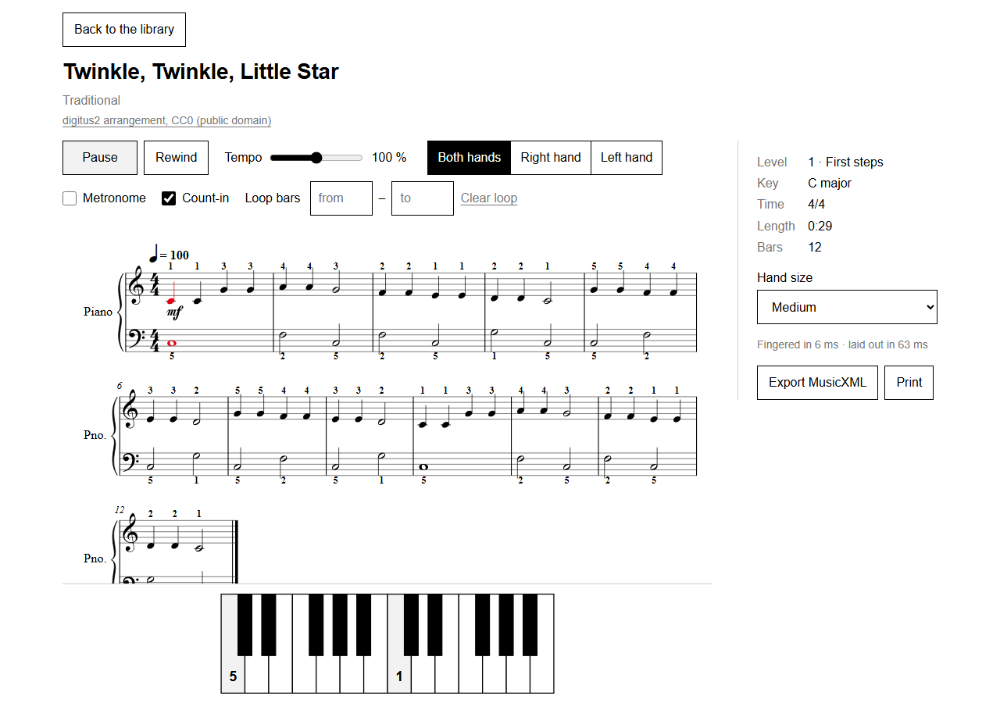
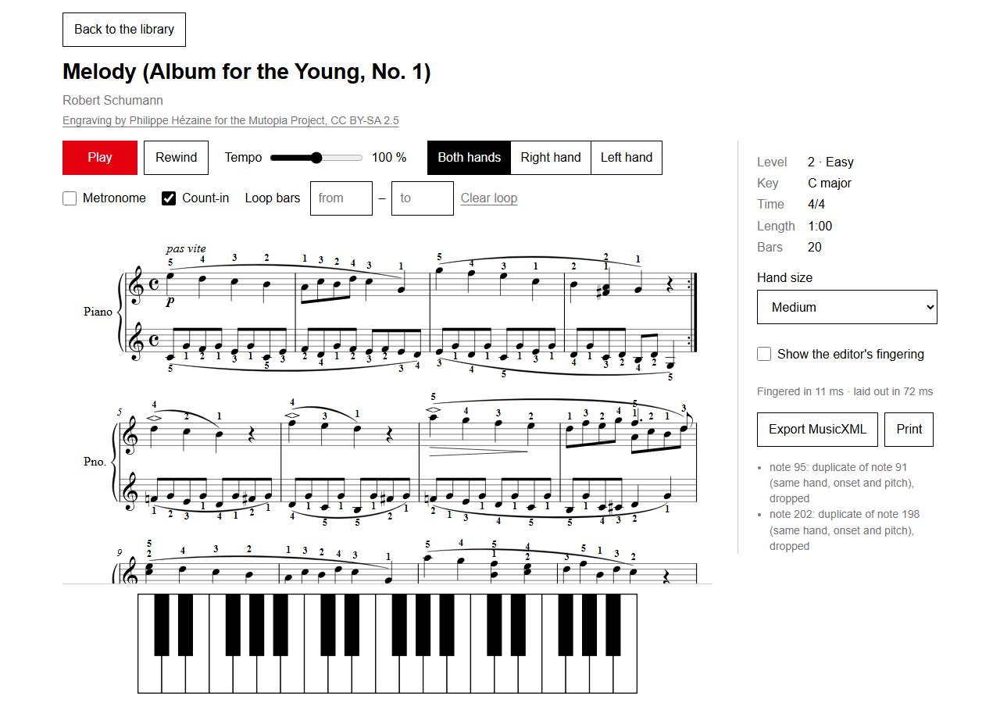

# UI review, 2026-10-14

The first periodic qualitative UI review (verification spec 3.10), by an independent Opus subagent that edited no product code. It walked the library, a score, playback, hand size, the editor's fingering, loop, export, print, About, dropped and wrong files, Back and reload, in Playwright's Chromium at 1280 x 900 and 360 x 740 (scripted walk, computed-style and horizontal-scroll checks on every step, a pixel audit of four screenshots). Audio was silent for most of the walk, and the reviewer could not listen, so sound and sync were not judged by ear.

Result: no blockers. The design brief held in every state: exactly one red root in the DOM, no other chromatic element, no horizontal scroll at either width. Thin digits and italic bar numbers can look faintly red in screenshots from subpixel text antialiasing; their computed fill is black, so this is not a defect.

Severity: blocker (a beginner cannot proceed), major (a beginner will be confused or stuck), minor (friction), nit (polish).

## Findings cited from code and findings still open

The finding ids are cited in code comments and tests (`apps/web`, `S3` to `S12`). All findings of this review other than the open ones below were fixed.

| #   | Severity        | Finding                                                                                                                                                                                                                                                                                                                                                               | Status |
| --- | --------------- | --------------------------------------------------------------------------------------------------------------------------------------------------------------------------------------------------------------------------------------------------------------------------------------------------------------------------------------------------------------------- | ------ |
| S3  | major           | Play gave no feedback while it was working. On the first real Play the samples took 2.35 s to load while the button still read "Play" and stayed red; then the count-in (on by default) held the red cursor on the first notes, with keys 5 and 1 pressed, for another 2.4 s before anything was meant to sound. No status line said "Loading the piano…" or counted. | Fixed  |
| S4  | major           | The finger numbers were never explained: no screen said that 1 is the thumb and 5 the little finger in both hands, or which staff is which hand. The keyboard showed digits with no L or R.                                                                                                                                                                           | Fixed  |
| S5  | major           | The cursor was small: the red element during playback was the notehead itself, 9 x 8 px at both widths, easy to lose in a sixteenth-note run. Pressed keys used `--gray-1` (#f2f2f2) on white, almost invisible.                                                                                                                                                      | Fixed  |
| S6  | major (content) | Every note carries a digit. Schumann's Melody has 254 engine digits against the editor's 27; in its left hand the digits form two rows under the staff, and K.545 bar 29 stacks digits against the slur and beams. This is the readability reduction (verification spec 3.6, milestone M5), the biggest readability problem a teacher would see.                      | Open   |
| S7  | minor           | Developer text in the side panel: "Fingered in 6 ms · laid out in 63 ms" on every piece, and engine warnings such as "note 95: duplicate of note 91 (same hand, onset and pitch), dropped". A beginner cannot act on either.                                                                                                                                          | Fixed  |
| S8  | minor           | The tempo control read "70 %" while the score printed "♩ = 100", and a tempo set for one hard piece persisted and carried to every other piece.                                                                                                                                                                                                                       | Fixed  |
| S9  | minor           | Hand size (Large, Medium, Small, Child) had no explanation of what it changes; "Child" can read as an easier mode.                                                                                                                                                                                                                                                    | Fixed  |
| S10 | minor           | One-hand practice did not dim the muted hand's staff or digits, so the score did not show what was being played.                                                                                                                                                                                                                                                      | Fixed  |
| S11 | minor           | A reversed loop range (from 6, to 2) was silently ignored.                                                                                                                                                                                                                                                                                                            | Fixed  |
| S12 | minor           | The editor's fingering had no on-score label; the jump from 254 to 27 digits could look like a bug when the checkbox was off-screen.                                                                                                                                                                                                                                  | Fixed  |
| S13 | nit             | The score is drawn at one fixed scale (`VEROVIO_SCALE = 40`: noteheads 9 px, digit boxes 14 px, Times bold): readable, but small for a laptop on a music stand.                                                                                                                                                                                                       | Open   |
| L4  | nit             | `#/piece/does-not-exist` falls back to the library with no notice.                                                                                                                                                                                                                                                                                                    | Open   |

## Piano-teacher notes

These use the engine's fingering at the app's default hand size (Medium) with the `parncutt` weight set, read from the screen and cross-checked with `digitus2 finger <file> --profile medium`. Bar 0 is a pickup. "RH" means right hand, "LH" left hand. `digitus2 lint --beginner` reported 0 errors and 0 warnings on Twinkle and Happy Birthday, so none of the objections below were visible to the lint rules of the time. The rules L15 (a thumb crossing inside one five-finger position, a warning for beginners) and L24 (an info showing a beginner every crossing that moves the hand), the consistent-repeats pass and the `beginner` level come from these notes. The recommended weight set `learned-open` does not cross in Twinkle bars 3 to 4.

### Twinkle, Twinkle, Little Star (first level 1 piece, C major)

| Bars                | Hand | Engine                       | Objection                                                                                                                                      | What a teacher would write                                                                                                                                                           |
| ------------------- | ---- | ---------------------------- | ---------------------------------------------------------------------------------------------------------------------------------------------- | ------------------------------------------------------------------------------------------------------------------------------------------------------------------------------------ |
| 1 to 2 and 9 to 10  | RH   | C4 1 1, G4 3 3, A4 4 4, G4 3 | Thumb to 3 spans a fifth, and the G that bars 5 and 7 play with 5 is played with 3 here. A first-piece student learns two fingers for one key. | Stay in C position (1 to 5 on C to G) for the whole piece                                                                                                                            |
| 3 to 4 and 11 to 12 | RH   | F4 2 2, E4 1 1, D4 2 2, C4 1 | The thumb moves up to E, then finger 2 crosses over it to D: a cross-over in the first phrase of the first piece.                              | One crossing-free option is C position with the fifth finger reaching up to A: 1 1 5 5, 5 5 5, 4 4 3 3, 2 2 1. Bars 1 to 4 then use the same fingers as the engine's own bars 5 to 8 |
| all                 | LH   | C3 5, F3 2, G3 1             | Fine: C position throughout.                                                                                                                   | —                                                                                                                                                                                    |

### Happy Birthday to You (first level 2 piece, G major, 3/4)

| Bars         | Hand | Engine                                                       | Objection                                                                                                                                                                                                                      | What a teacher would write             |
| ------------ | ---- | ------------------------------------------------------------ | ------------------------------------------------------------------------------------------------------------------------------------------------------------------------------------------------------------------------------ | -------------------------------------- |
| 0 to 4       | RH   | D4 1 1 pickups, E 2, D 1, G 4 / F# 3 / A 5                   | Fine and idiomatic (D position).                                                                                                                                                                                               | —                                      |
| 5 to 6       | RH   | D5 5, B4 3, G4 1, then F#4 2, E4 1, C5 5 5                   | Finger 2 crosses over the thumb into the fermata: the hardest move in the piece. It is acceptable, and many editions print the same 5 3 1, 2 1. A teacher would mark the crossing for a level 2 student rather than change it. | — (keep, and point out the crossing)   |
| 2 vs 3 and 7 | LH   | D3 + A3 as 5-1 in bar 2, 4-1 in bar 3 and on beat 3 of bar 7 | The same fifth gets two fingerings.                                                                                                                                                                                            | 5-1 every time                         |
| 6            | LH   | C3 + G3 as 3-1                                               | A fifth between 1 and 3 is an uncomfortable stretch for a level 2 hand.                                                                                                                                                        | 5-1, moving the hand at the bar line   |
| all          | both | 43 digits on 8 bars                                          | Every pickup D carries "1 1" again (S6).                                                                                                                                                                                       | Print the first one, and the C5 5 leap |

### Other level 1 and 2 pieces

| Piece                                                    | Bars          | Engine                                                        | Objection                                                                                                                |
| -------------------------------------------------------- | ------------- | ------------------------------------------------------------- | ------------------------------------------------------------------------------------------------------------------------ |
| Ode to Joy (level 1)                                     | 1 vs 5 and 13 | bar 1 RH E4 2 2, F4 3, G4 5; bars 5 and 13 E4 3 3, F4 4, G4 5 | The very first bar skips finger 4 between F and G and differs from its own repeats. A teacher writes 3 3 4 5 every time. |
| Frère Jacques (level 1)                                  | 7 vs 8        | RH C4 2, G3 1, C4 3, then C4 3, G3 1, C4 3                    | Two identical bars, two fingerings, and C4 changes finger inside bar 7. Use 3-1-3 both times.                            |
| Mary Had a Little Lamb (level 1)                         | all           | C position, 1 to 5                                            | No objection.                                                                                                            |
| Jingle Bells (level 1)                                   | 7 vs 15       | LH G3 1, D3 4 in bar 7; G3 1, D3 2 in bar 15                  | Minor: the same LH move is fingered two ways.                                                                            |
| Melody, Schumann (level 2, editor's fingering available) | 4             | RH B4 2, then F#4 1 + A4 2                                    | Finger 2 slides from B to A. The editor has B4 1, F#4 2 + A4 3.                                                          |
|                                                          | 5             | RH D5 4, C5 2, B4 1                                           | Skips 3 in a stepwise line. The editor starts on 3.                                                                      |
|                                                          | 6             | RH F5 4, E5 3, D5 1                                           | Skips 2 in a stepwise line. The editor starts on 3.                                                                      |

The pattern a teacher would name: **the engine did not finger the same passage the same way** (Twinkle G, Ode to Joy bar 1, Frère Jacques bars 7 and 8, Happy Birthday LH). It also accepted a crossing or a skipped finger where a five-finger position would do, in pieces whose whole point is five-finger positions. Both are cheap to detect automatically: a repeated-passage consistency check, and a no-crossing-in-a-five-finger-span rule for levels 1 and 2.

## Screenshots

- `ui-2026-10-14/desktop-twinkle-count-in.png`: Twinkle at 1280, 2.5 s after Play, still in the count-in. The red cursor and keys 5 and 1 are lit before anything sounds (S3). Bars 1 to 4 show the RH 1 1 3 3 | 4 4 3 | 2 2 1 1 | 2 2 1 fingering discussed above.
- `ui-2026-10-14/desktop-melody-engine-digits.png`: Schumann's Melody with the engine's 254 digits and the engine warnings in the side panel (S6, S7).

